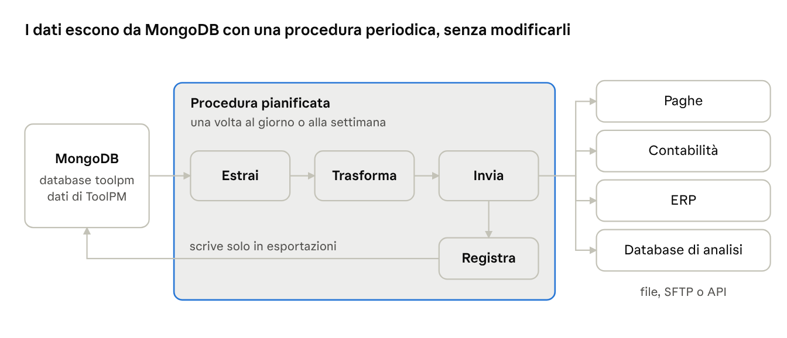

# ToolPM — Consuntivazione costi di progetto

17/11/2026 · Claudio Agasi

> Analisi della sezione **Consuntivazione** (nessun codice ancora scritto). Versione di lavoro con commenti: [documento su Claude](https://claude.ai/artifact/DaCYgfRoJpWhxxaWgQYMFt). Questo file è la copia salvata nel repository al 17/11/2026.

## Introduzione

La nuova sezione **Consuntivazione** di ToolPM raccoglie le ore lavorate da ogni risorsa, giorno per giorno e progetto per progetto, e ne ricava il costo del personale per progetto e per centro di costo. Il documento contiene l'analisi funzionale, l'analisi tecnica, le integrazioni con altri sistemi e il modello dei dati su MongoDB, il database scelto per tutto ToolPM. Non è stato ancora scritto codice.

*Revisione del 16/11/2026: aggiornata con le risposte ai punti aperti (tipologie di costo configurabili, tariffe standard per ruolo e personalizzate, più approvatori per progetto, nessun cambio di centro di costo) e con la dimensione aziendale di circa 200 dipendenti.*

*Revisione successiva: aggiunte le attività di progetto (si può consuntivare su un'attività invece che sul progetto), la vista del costo del singolo progetto, le procedure di esportazione per integrazioni future e i campi di ultimo salvataggio e utente su tutti i dati.*

*Revisione del 17/11/2026: confermate le sette ipotesi rimaste aperte; dati comuni in un modulo Comuni (`/api/comuni`); approvazione su due livelli con i profili approvatore TL (supervisione, facoltativa) e approvatore PM (convalida, obbligatoria).*

*Revisione del 17/11/2026, seconda parte: anagrafica completa del progetto (titolo, descrizione, cliente, date, quattro stime impostate a mano), stati In valutazione, In corso e Chiuso, progetti creati da TL e PM, stima in giorni facoltativa sulle attività.*

*Revisione del 17/11/2026, terza parte: nuovo profilo approvatore PMSenior; chi gestisce clienti, centri di costo, progetti, attività e risorse; email (nome utente) e cellulare delle risorse; date del progetto facoltative fino ai passaggi In corso e Chiuso.*

*Revisione del 17/11/2026, quarta parte: chiusi tutti i punti aperti. Il PMSenior vede i costi e approva come PM su tutti i progetti; il TL modifica le caratteristiche solo delle risorse che lavorano sui suoi progetti.*

*Revisione del 17/11/2026, quinta parte: percentuale di completamento di progetti e attività; indicatori Earned Value (EVM) che dicono se il progetto è in linea con tempi e costi.*

*Revisione del 17/11/2026, sesta parte: confermate tutte le ipotesi su percentuale di completamento ed EVM; nessun punto aperto.*

**Perimetro.** Sono inclusi i costi delle circa 200 risorse interne (programmatori, analisti, designer UI/UX, project manager, team leader, architetti IT, sistemisti, tester e altri ruoli). Restano fuori, per ora: ferie, permessi e malattia; integrazione con paghe o HR; costi non legati al personale (licenze, hardware, trasferte); ricavi e fatturazione. Il modello è pensato per poterli aggiungere in seguito.

**Glossario**

| Termine | Significato |
| --- | --- |
| Risorsa | Persona che lavora sui progetti. È la stessa entità già usata dal Pianificatore. |
| Ruolo | Profilo professionale della risorsa (es. analista, tester). Determina la tariffa standard. |
| Progetto | Lavoro su cui si consuntivano ore, per un cliente oppure interno. Ha uno stato (In valutazione, In corso, Chiuso), date di inizio e fine e quattro stime impostate a mano. Ha un solo centro di costo, almeno un approvatore PM e, se serve, uno o più approvatori TL. |
| Attività | Parte di un progetto (es. analisi, sviluppo, collaudo) su cui si può consuntivare al posto del progetto. Appartiene a un solo progetto. |
| Centro di costo (CdC) | Contenitore contabile che riceve i costi di uno o più progetti. |
| Approvatore | Persona a cui, su un progetto, è assegnato un profilo di approvazione. Approvatore TL: supervisiona e dà un primo via libera, facoltativo. Approvatore PM: convalida in modo definitivo; solo la sua approvazione rende valida una riga. Approvatore PMSenior: tutto ciò che fa il PM, più la creazione di clienti, centri di costo e risorse. Il profilo non dipende dal ruolo della persona nel progetto. |
| Tipologia di costo | Tipo di ora con un proprio costo orario: ordinaria, straordinaria, straordinaria notturna, straordinaria festiva, più quelle che si vorranno aggiungere. |
| Tariffa standard | Costo orario per tipologia, valido per tutte le risorse di un ruolo in un intervallo di date. |
| Tariffa personalizzata | Costo orario per tipologia di una singola risorsa, in un intervallo di date. Prevale sulla tariffa standard. |
| Consuntivo | Ore dichiarate da una risorsa in una giornata, divise in righe per progetto (o attività) e tipologia di costo. |
| Costo consuntivato | Ore × tariffa applicabile alla risorsa in quella data, per quella tipologia. Alimenta attività (se presente), progetto e centro di costo. |
| Percentuale di completamento | Quanto del lavoro di un progetto o di un'attività è stato fatto, da 0 a 100. È impostata a mano, non calcolata. |
| Risorsa assegnata | Risorsa indicata come esecutrice di un'attività; può aggiornarne la percentuale di completamento. |
| EVM (Earned Value Method) | Metodo che confronta, a una data, il lavoro pianificato (PV), il lavoro fatto (EV) e il costo sostenuto (AC), e ne ricava se il progetto è in linea con tempi e costi. |

## Analisi funzionale

Ogni giorno la risorsa dichiara quante ore ha lavorato, su quali progetti o attività di progetto e con quale tipologia di costo. Il sistema valorizza ogni ora con la tariffa applicabile alla risorsa in quella data: quella personalizzata se c'è, altrimenti quella standard del suo ruolo. L'approvatore TL del progetto può dare un primo via libera; la riga diventa valida solo con l'approvazione dell'approvatore PM. I costi approvati si vedono a tre livelli: per attività, per singolo progetto e per centro di costo. Il costo di una riga su un'attività alimenta l'attività, il progetto a cui appartiene e il centro di costo di quel progetto.


La riga di consuntivo appartiene alla giornata di una risorsa, punta sempre a un progetto e, se la risorsa ha scelto un'attività, anche all'attività (linea tratteggiata, facoltativa). Da progetto e attività il costo risale al centro di costo. La tariffa si cerca prima tra quelle personalizzate della risorsa, poi tra quelle standard del suo ruolo. La linea blu collega i progetti ai loro approvatori, che sono risorse con un profilo TL o PM.

### Decisioni prese

| Tema | Decisione |
| --- | --- |
| Tipologie di costo | Configurabili da chi censisce i costi. Si parte da ordinaria, straordinaria, straordinaria notturna, straordinaria festiva; se ne possono aggiungere altre (es. una straordinaria notturna festiva con tariffa propria). Il sistema non decide quale tipologia si applica: la sceglie la risorsa. |
| Tariffe | Standard per ruolo; in più, tariffa personalizzata per la singola risorsa, che prevale sempre sulla standard per le tipologie che contiene. Per le altre tipologie vale la standard. Una tipologia senza alcuna tariffa lascia la riga "da valorizzare". |
| Progetto e centro di costo | Un progetto ha un solo centro di costo, che non cambia nel tempo e non si ripartisce. |
| Attività | Un progetto può avere attività. Si consuntiva sul progetto oppure su una sua attività; il costo di un'attività alimenta il suo progetto e il centro di costo del progetto. Le attività hanno un solo livello, senza sotto-attività. Un progetto con attività accetta anche ore dirette, salvo che sia attiva l'opzione "solo su attività" (disattivata di default). |
| Visibilità dei costi | Oltre al totale per centro di costo, si vede il costo del singolo progetto e, al suo interno, il dettaglio per attività. |
| Approvazione | Su due livelli, per ogni riga (anche su attività). L'approvatore TL supervisiona e dà un primo via libera, che non è obbligatorio. Solo l'approvazione dell'approvatore PM rende valida la riga e la fa entrare nei costi. Se ci sono più PM, o più TL, basta l'approvazione di uno di loro. |
| Profili di approvazione | Tre profili, indipendenti dal ruolo che la persona ha nel progetto: approvatore TL, approvatore PM e approvatore PMSenior. Ogni utente ha un'abilitazione generale a uno dei tre; sul singolo progetto è assegnato come TL o come PM (almeno un PM obbligatorio, TL facoltativi). Chi crea un progetto ne diventa approvatore con il proprio profilo. Il PMSenior può fare tutto ciò che fa il PM, più quanto indicato in "Chi gestisce le anagrafiche"; vede i costi di tutti i progetti e può approvare come PM su tutti i progetti, anche dove non è assegnato. Le abilitazioni le assegna l'amministratore di sistema. |
| Regole di approvazione | Il TL approva le ore consuntivate sul progetto e sulle sue attività e può respingere una riga, con motivazione. Una riga inviata di nuovo dopo un rifiuto riparte senza via libera del TL. La stessa persona può essere TL e PM sullo stesso progetto; in quel caso approva direttamente come PM. I profili sono TL, PM e PMSenior, valori fissi. |
| Gestione delle attività | Le attività di un progetto le creano e le modificano solo gli approvatori TL e PM di quel progetto e i PMSenior, nessun altro utente. |
| Gestione degli approvatori | Chi è TL e chi è PM su un progetto lo decidono solo il PM del progetto e i PMSenior; il TL no. Chi crea il progetto ne diventa approvatore con il proprio profilo (decisione del 19/11/2026). |
| Allocazioni del TL nel Pianificatore | Il TL alloca qualsiasi risorsa sui progetti di cui è approvatore e modifica o toglie quelle allocazioni; non tocca le allocazioni su progetti di altri. Skill e certificazioni di una risorsa le modifica solo se la risorsa lavora su un suo progetto. Il catalogo di skill, certificazioni e scale resta a PM e PMSenior (decisioni del 19/11/2026). |
| Chi gestisce le anagrafiche | Clienti e centri di costo: PMSenior. Progetti: TL, PM e PMSenior. Attività: TL e PM del progetto, PMSenior. Risorse: PM e PMSenior. Caratteristiche delle risorse (skill, certificazioni, pianificazione e simili): PM e PMSenior su tutte le risorse, TL solo sulle risorse che lavorano sui suoi progetti. Ruolo professionale e orario contrattuale: PM e PMSenior; le tariffe restano al controller. |
| Risorse | Ogni risorsa ha un'email, obbligatoria e usata anche come nome utente per accedere al sistema, e un numero di cellulare facoltativo. |
| Creazione dei progetti | Un progetto lo crea un TL, un PM o un PMSenior, che ne diventa approvatore con il proprio profilo. È sempre legato a un centro di costo; il cliente è facoltativo (progetto interno). Le attività sono sempre legate a un progetto. |
| Stati del progetto | In valutazione, In corso, Chiuso. Non si consuntiva su un progetto Chiuso né sulle sue attività. Le date sono facoltative: l'inizio diventa obbligatorio quando il progetto passa In corso, la fine quando passa a Chiuso. Si consuntiva anche su un progetto In valutazione. I passaggi In valutazione → In corso → Chiuso li decidono TL o PM del progetto o un PMSenior; un progetto Chiuso torna In corso solo per decisione di un PM o di un PMSenior. Le righe già inviate quando il progetto viene chiuso restano approvabili e respingibili, ma non se ne aggiungono né se ne modificano. |
| Stime e consuntivato | Il progetto ha quattro stime impostate a mano da chi lo modifica, mai calcolate: manageriale in giorni, manageriale in euro, definitiva in giorni (effort), definitiva in euro. Il consuntivato è invece sempre calcolato dalle righe sul progetto e sulle sue attività. Le attività hanno una stima in giorni facoltativa, che non concorre alle stime del progetto. Il TL vede e imposta anche le stime in euro, ma non vede tariffe né costo consuntivato. Per confrontare ore e stime in giorni, 1 giorno = 8 ore (parametro configurabile). |
| Percentuale di completamento | Progetti e attività hanno una percentuale di completamento. Quella di un'attività la modificano la risorsa assegnata all'attività, il TL e il PM approvatori del progetto e i PMSenior. Quella del progetto la modificano solo gli approvatori TL e PM del progetto e i PMSenior; una risorsa che non è approvatrice non può modificarla. Il PMSenior può farlo su tutti i progetti e tutte le attività. |
| Avanzamento (EVM) | Da stima, consuntivato e percentuale di completamento il sistema calcola con il metodo Earned Value se il progetto è in linea con i tempi e con i costi, e mostra in quale stato si trova per i tempi e per i costi. |
| Regole dell'EVM | Le risorse assegnate a un'attività sono un elenco esplicito, gestito da TL e PM del progetto e dai PMSenior. Il budget (BAC) è la stima definitiva; se manca, quella manageriale. Il lavoro pianificato (PV) si distribuisce in modo lineare tra data di inizio e data di fine; in futuro potrà venire dalle allocazioni del Pianificatore. Il costo effettivo (AC) conta solo le righe approvate dal PM. Soglie degli stati 0,85, 0,95 e 1,05, configurabili. Il TL vede gli indicatori in giorni, gli indici e gli stati, non gli importi in euro. L'EVM si calcola per i progetti In corso e Chiusi, non per quelli In valutazione. |
| Dati comuni | Risorse, ruoli, clienti, progetti con attività e approvatori, centri di costo passano in un modulo Comuni (/api/comuni), condiviso da tutte le sezioni. Il Pianificatore li legge da lì. |
| Budget | Nessun budget separato: il riferimento sono le stime del progetto, confrontate con il consuntivato. |
| Ferie, permessi, malattia | Esclusi per ora; possibile estensione futura. |
| Paghe e HR | Nessuna integrazione per ora; possibile estensione futura tramite procedure di esportazione. |
| Dimensione | Circa 200 dipendenti. |

### Attori

| Attore | Cosa fa |
| --- | --- |
| Risorsa | Inserisce e invia il proprio consuntivo. Aggiorna la percentuale di completamento delle attività a cui è assegnata. Vede solo le proprie ore, non le tariffe né i costi. |
| Approvatore TL | Supervisore (una specie di Team Leader). Può creare progetti. Sui progetti a cui è assegnato controlla le righe inviate (ore, straordinari, attività) e dà un primo via libera, che segnala al PM la sua supervisione ma non rende valida la riga. Crea e modifica le attività dei propri progetti e le caratteristiche delle risorse che ci lavorano. Vede ore, tipologie e stime del progetto, non tariffe né costi consuntivati. |
| Approvatore PM | Una specie di Project Manager. Può creare progetti. Sui progetti a cui è assegnato approva in modo definitivo o respinge le righe, con o senza il via libera del TL. Solo la sua approvazione rende valida la riga. Crea e modifica le attività dei propri progetti. Vede ore e costi di quei progetti. |
| Approvatore PMSenior | Fa tutto ciò che fa il PM. In più crea clienti e centri di costo e, come il PM, risorse; crea e modifica progetti e attività e le caratteristiche delle risorse. Vede i costi di tutti i progetti e può approvare come PM su tutti. |
| Controller / amministrazione | Gestisce tipologie di costo, tariffe standard e personalizzate. Chiude i periodi. Vede tutti i costi. |
| Amministratore di sistema | Gestisce utenti, abilitazioni (TL, PM, PMSenior) e ruoli applicativi. |

### Requisiti funzionali

**Anagrafiche**

1. **RF-01 Clienti e progetti.** Il progetto lo crea un TL, un PM o un PMSenior; i clienti li crea il PMSenior. Attributi: codice identificativo univoco, titolo, descrizione, cliente (facoltativo: assente nei progetti interni), data di inizio e data di fine, stato (RF-26), centro di costo (obbligatorio), le quattro stime (RF-24), opzione "solo su attività", approvatori con il loro profilo (almeno un PM; TL facoltativi), assegnati dal PM del progetto o da un PMSenior. Il centro di costo non si può cambiare dopo il primo consuntivo. Il Pianificatore userà la stessa anagrafica al posto del testo libero di oggi.
2. **RF-02 Centri di costo.** Codice, descrizione, stato. Un centro di costo riceve i costi di uno o più progetti. Li crea il PMSenior.
3. **RF-03 Risorse e ruoli.** Si riusa l'anagrafica risorse del Pianificatore, aggiungendo email (obbligatoria, unica, usata come nome utente per l'accesso), cellulare, matricola, date di ingresso e uscita, orario contrattuale giornaliero e ruolo. Il ruolo ha uno storico con data di decorrenza, perché da esso dipende la tariffa standard. Le risorse le creano PM e PMSenior; le caratteristiche (skill, certificazioni, pianificazione e simili) le modificano PM e PMSenior per tutte le risorse e il TL per le risorse che lavorano sui suoi progetti (allocate nel Pianificatore o con ore consuntivate su un progetto di cui è TL). Ruolo e orario contrattuale li modificano PM e PMSenior. Il cellulare è facoltativo.
4. **RF-04 Tipologie di costo.** Anagrafica configurabile: codice, descrizione, ordine di visualizzazione, categoria (ordinaria o straordinaria), attiva sì/no. Una tipologia usata non si cancella, si disattiva.
5. **RF-05 Tariffe standard per ruolo.** Per ogni ruolo e tipologia di costo, un costo orario con data di inizio validità (e una di fine facoltativa).
6. **RF-06 Tariffe personalizzate.** Per una singola risorsa e una o più tipologie, un costo orario con validità. Prevale sulla tariffa standard del ruolo.

**Consuntivazione**

7. **RF-07 Consuntivo giornaliero.** La risorsa sceglie una data e inserisce una o più righe: progetto oppure attività di un progetto, tipologia di costo, ore, nota facoltativa. Nella stessa giornata può lavorare su più progetti e attività, e con più tipologie sulla stessa voce.
8. **RF-08 Vista settimanale.** Griglia progetti e attività × giorni con totali per riga e per giorno. Propone i progetti su cui la risorsa è allocata nel Pianificatore in quel mese.
9. **RF-09 Copia.** Copia del giorno o della settimana precedente come bozza.
10. **RF-10 Invio.** La risorsa invia una o più giornate: tutte le righe passano in attesa di approvazione.
11. **RF-11 Approvazione su due livelli.** L'approvatore TL vede, in un elenco, le righe inviate sui propri progetti e dà il via libera o le respinge, anche in blocco, con motivazione per il rifiuto. L'approvatore PM vede le righe inviate e quelle già approvate dal TL, distinte da una colonna "via libera TL" (chi e quando), e le approva in modo definitivo o le respinge, anche in blocco. Il via libera del TL non è obbligatorio. Le righe della stessa giornata su progetti diversi seguono strade indipendenti. Le righe respinte tornano modificabili dalla risorsa.
12. **RF-12 Chiusura del periodo.** Il controller chiude un mese: le righe del mese non sono più modificabili, salvo riapertura motivata.

**Costi e report**

13. **RF-13 Calcolo del costo.** Per ogni riga: costo = ore × tariffa applicabile alla risorsa, per quella tipologia, in quella data (vedi sotto).
14. **RF-14 Costo per progetto.** Scheda costi del singolo progetto: ore e costo totale in un periodo e dall'inizio del progetto, con dettaglio per attività, risorsa, ruolo, tipologia di costo e mese. Le ore consuntivate direttamente sul progetto compaiono come voce "senza attività".
15. **RF-15 Costo per centro di costo.** Totale dei progetti associati, con dettaglio per progetto.
16. **RF-16 Pianificato e consuntivato.** Confronto tra la percentuale di allocazione del Pianificatore e le ore consuntivate, per risorsa, progetto e mese.
17. **RF-17 Esportazione.** Excel/CSV dei report e delle righe di dettaglio.
18. **RF-18 Ricalcolo.** Dopo una correzione retroattiva di una tariffa, il sistema mostra le righe interessate e ne ricalcola il costo su conferma del controller, tenendo traccia della modifica.

**Attività di progetto**

19. **RF-19 Anagrafica attività.** Per ogni progetto, un elenco di attività: codice (univoco nel progetto), descrizione, date di inizio e fine facoltative, stato (attiva, chiusa), stima in giorni facoltativa. Un'attività appartiene a un solo progetto e non si sposta su un altro dopo il primo consuntivo. Le attività le creano e le modificano solo gli approvatori TL e PM del progetto e i PMSenior.
20. **RF-20 Consuntivazione su attività.** In ogni riga la risorsa sceglie il progetto oppure una sua attività. Scegliendo l'attività, il progetto è implicito. La risorsa può consuntivare su tutte le attività attive dei progetti non chiusi, anche quelle a cui non è assegnata: la pagina mostra per prime le attività assegnate e avvisa quando se ne sceglie una non assegnata; dalla fase 3 l'approvatore vede evidenziate quelle righe (decisione del 20/11/2026).
21. **RF-21 Ribaltamento dei costi.** Il costo di una riga su un'attività si somma all'attività, al progetto a cui l'attività appartiene e al centro di costo di quel progetto, una sola volta per livello.
22. **RF-22 Costo per attività.** Ore e costo per attività in un periodo, dentro la scheda del progetto e nei report, con dettaglio per risorsa e tipologia di costo.
23. **RF-23 Approvazione delle attività.** Le righe su un'attività le approvano gli approvatori TL e PM del progetto a cui l'attività appartiene, con le stesse regole.

**Progetto: stime e ciclo di vita**

24. **RF-24 Stime del progetto.** Quattro valori impostati a mano da chi modifica il progetto, mai calcolati: stima manageriale in giorni, stima manageriale in euro, stima definitiva in giorni (effort), stima definitiva in euro. La stima in giorni delle attività, facoltativa, non concorre a nessuna di queste.
25. **RF-25 Consuntivato del progetto.** Ore, giorni e costo consuntivati sono sempre calcolati dalle righe approvate dal PM sul progetto e sulle sue attività. La scheda del progetto li affianca alle stime: giorni consuntivati contro stime in giorni, costo contro stime in euro; per ogni attività, giorni consuntivati contro la sua stima, se c'è.
26. **RF-26 Stati del progetto.** In valutazione, In corso, Chiuso. Non si consuntiva su un progetto Chiuso né sulle sue attività: la griglia della risorsa non li propone e il backend rifiuta righe nuove o modificate su di essi. Le date di inizio e di fine sono facoltative: l'inizio è obbligatorio per passare In corso, la fine per passare a Chiuso.

**Avanzamento ed Earned Value**

27. **RF-27 Percentuale di completamento.** Progetti e attività hanno una percentuale di completamento da 0 a 100, impostata a mano. Quella del progetto la modificano solo i suoi approvatori TL e PM e i PMSenior; quella di un'attività anche le risorse assegnate all'attività. Ogni modifica è registrata con valore, data e autore.
28. **RF-28 Risorse assegnate alle attività.** Ogni attività ha l'elenco delle risorse assegnate, gestito da TL e PM del progetto e dai PMSenior.
29. **RF-29 Indicatori EVM del progetto.** A una data di riferimento (di default oggi) il sistema calcola PV, EV, AC, gli scostamenti SV e CV, gli indici SPI e CPI e le previsioni EAC, ETC, VAC e TCPI, in euro e in giorni (vedi "Calcolo dell'avanzamento (EVM)").
30. **RF-30 Stato di tempi e costi.** Il sistema traduce SPI e CPI in uno stato dei tempi (In anticipo, In linea, In ritardo, In forte ritardo) e uno stato dei costi (Sotto budget, In linea, Sopra budget, Fortemente sopra budget), mostrati con un colore nella scheda del progetto e nell'elenco dei progetti.
31. **RF-31 Andamento nel tempo.** Ogni notte il sistema salva gli indicatori di ogni progetto In corso, per mostrare l'andamento di PV, EV e AC e degli indici nel tempo.
32. **RF-32 Indicatori delle attività.** Per un'attività con stima in giorni il sistema mostra EV, AC e CPI in giorni; SPI e stato dei tempi solo se l'attività ha date di inizio e di fine.

### Calcolo del costo

La tariffa di una riga si cerca in quest'ordine, per la tipologia della riga e alla data della riga:

1. tariffa personalizzata della risorsa;
2. altrimenti tariffa standard del ruolo che la risorsa aveva in quella data;
3. altrimenti la riga resta "da valorizzare" e il controller riceve un avviso.

```latex
\text{costo}_{\text{riga}} = \text{ore} \times \text{tariffa}(\text{risorsa}, \text{tipologia}, \text{data})
```

```latex
\text{costo}_{\text{attività}} = \sum_{\text{righe approvate sull'attività}} \text{costo}_{\text{riga}} \qquad \text{costo}_{\text{progetto}} = \sum_{\text{righe approvate sul progetto senza attività}} \text{costo}_{\text{riga}} + \sum_{\text{attività del progetto}} \text{costo}_{\text{attività}}
```

```latex
\text{costo}_{\text{CdC}} = \sum_{\text{progetti del CdC}} \text{costo}_{\text{progetto}}
```

Esempio con valori ipotetici. Il ruolo "Sviluppatore senior" ha tariffe standard di 30, 39, 45 e 51 €/h per le quattro tipologie iniziali; la risorsa ha una tariffa personalizzata solo per l'ordinaria, a 32 €/h. In una giornata consuntiva 6 ore ordinarie sull'attività "Sviluppo" del progetto A, 2 ore straordinarie direttamente sul progetto A e 2 ore ordinarie sull'attività "Collaudo" del progetto B.

| Progetto | Attività | Tipologia | Ore | Tariffa usata | €/h | Costo (€) |
| --- | --- | --- | --- | --- | --- | --- |
| A | Sviluppo | Ordinaria | 6 | Personalizzata | 32 | 192 |
| A | — (sul progetto) | Straordinaria | 2 | Standard del ruolo | 39 | 78 |
| B | Collaudo | Ordinaria | 2 | Personalizzata | 32 | 64 |
| **Totale** |  |  | **10** |  |  | **334** |

Quel giorno l'attività "Sviluppo" costa 192 € e il progetto A 270 €: 192 € dall'attività più 78 € consuntivati direttamente sul progetto. Il progetto B costa 64 €, tutti dall'attività "Collaudo". Il centro di costo di A riceve 270 €, quello di B 64 €. Le righe di A e di B possono essere approvate da persone diverse e in momenti diversi; ciascuna entra nei report solo dopo l'approvazione del PM del proprio progetto.

### Calcolo dell'avanzamento (EVM)

Il metodo Earned Value confronta, a una data di riferimento, quanto lavoro si doveva aver fatto (PV), quanto se n'è fatto davvero (EV) e quanto è costato (AC). Si calcola sul progetto in euro e in giorni: la stima definitiva fa da budget, la percentuale di completamento dà il lavoro fatto, il consuntivato dà il costo.

| Grandezza | Significato | Come si calcola |
| --- | --- | --- |
| BAC | Budget a finire | Stima definitiva in euro (o in giorni); se manca, la stima manageriale |
| PV | Valore pianificato | BAC × quota della durata trascorsa tra data di inizio e data di fine |
| EV | Valore guadagnato | BAC × percentuale di completamento del progetto |
| AC | Costo effettivo | Costo (o giorni, 8 ore = 1 giorno) delle righe approvate dal PM fino alla data |
| SV, CV | Scostamento di tempi e di costi | EV − PV; EV − AC |
| SPI, CPI | Indice di tempi e di costi | EV / PV; EV / AC |
| EAC | Costo previsto a finire | BAC / CPI |
| ETC | Costo ancora da sostenere | EAC − AC |
| VAC | Scostamento previsto a finire | BAC − EAC |
| TCPI | Efficienza necessaria per chiudere nel budget | (BAC − EV) / (BAC − AC) |

```latex
\text{SPI} = \frac{\text{EV}}{\text{PV}} = \frac{\text{BAC} \times \%_{\text{completamento}}}{\text{BAC} \times \dfrac{\text{giorni trascorsi}}{\text{durata pianificata}}} \qquad \text{CPI} = \frac{\text{EV}}{\text{AC}}
```

SPI e CPI diventano lo stato mostrato all'utente. Le soglie sono configurabili.

| Valore dell'indice | Stato dei tempi (SPI) | Stato dei costi (CPI) |
| --- | --- | --- |
| ≥ 1,05 | In anticipo | Sotto budget |
| da 0,95 a 1,05 | In linea | In linea |
| da 0,85 a 0,95 | In ritardo | Sopra budget |
| < 0,85 | In forte ritardo | Fortemente sopra budget |

Esempio sul progetto TIMBUFE: stima definitiva 176.000 € e 440 giorni, dal 01/01/2027 al 31/12/2027. Al 02/07/2027, a metà della durata, il progetto è completo al 40% e sono stati consuntivati e approvati 80.000 €, pari a 200 giorni.

| Indicatore | Euro | Giorni |
| --- | --- | --- |
| PV | 88.000 | 220 |
| EV | 70.400 | 176 |
| AC | 80.000 | 200 |
| SV | −17.600 | −44 |
| CV | −9.600 | −24 |
| SPI | 0,80 | 0,80 |
| CPI | 0,88 | 0,88 |
| EAC | 200.000 | 500 |
| VAC | −24.000 | −60 |
| TCPI | 1,10 | 1,10 |

Il progetto è **In forte ritardo** sui tempi (SPI 0,80) e **Sopra budget** sui costi (CPI 0,88). Al ritmo attuale costerà 200.000 €, 24.000 € oltre la stima; per rientrare nel budget il lavoro restante dovrebbe rendere il 10% in più (TCPI 1,10).

Casi particolari: senza stima il progetto non ha indicatori; senza data di inizio o di fine PV, SPI e stato dei tempi risultano "Non calcolabili", mentre CPI e stato dei costi restano disponibili. La percentuale del progetto non si ricava da quelle delle attività; la scheda mostra per riferimento la media delle attività pesata sulla loro stima in giorni.

### Regole di business

- Le ore si inseriscono a passi di 15 minuti; ogni riga ha almeno 0,25 h.
- Il totale di una giornata non supera 24 ore.
- Se le ore delle tipologie di categoria "ordinaria" superano l'orario contrattuale della risorsa, il sistema lo segnala ma non blocca.
- Il sistema non verifica quale tipologia sia corretta per l'orario o per il giorno (notturno, festivo): la scelta spetta alla risorsa e la verifica all'approvatore.
- Ogni riga è su un progetto oppure su una sua attività, mai su entrambi in modo indipendente: se c'è l'attività, il progetto della riga è sempre quello dell'attività.
- Si consuntiva solo su progetti e attività attivi alla data, con tipologie attive, tra data di ingresso e di uscita della risorsa.
- Il costo di una riga si conta una sola volta per livello: nell'attività (se c'è), nel progetto e nel centro di costo. I totali di progetto non sommano due volte le righe delle attività.
- Il costo calcolato si memorizza sulla riga con la tariffa usata e la sua provenienza (personalizzata o standard): i report non cambiano se una tariffa cambia in seguito, salvo ricalcolo esplicito (RF-18).
- Una riga approvata non si modifica più; per correggerla un approvatore PM deve prima respingerla.
- Un progetto non si può attivare senza almeno un approvatore PM. I TL sono facoltativi.
- Solo le righe approvate dal PM (o in un mese chiuso) entrano nei costi, nei report e nelle esportazioni; il solo via libera del TL non basta.
- Su un progetto Chiuso, e sulle sue attività, non si possono creare né modificare righe.
- Ogni modifica a righe approvate, tariffe, tipologie, attività e approvatori viene registrata (chi, quando, valore prima e dopo).

### Stati di una riga

L'approvazione avviene per progetto e su due livelli (TL facoltativo, PM obbligatorio), quindi lo stato appartiene alla singola riga. Lo stato della giornata è un riepilogo (es. "3 righe approvate su 4").


Le righe della stessa giornata su progetti diversi passano per questi stati in modo indipendente. Il PM può approvare sia una riga inviata sia una già approvata dal TL: in entrambi i casi la riga diventa approvata e conta nei costi. Un mese chiuso si può riaprire solo dal controller, con motivazione registrata nello storico.

### Requisiti non funzionali

- **Riservatezza.** Tariffe e costi li vedono solo il controller e, per i propri progetti, gli approvatori PM; i PMSenior li vedono per tutti i progetti. Gli approvatori TL vedono ore, tipologie e stime del progetto, non tariffe né costi consuntivati. Serve un'autenticazione con utenti e ruoli, che oggi ToolPM non ha.
- **Volumi.** Con 200 risorse, circa 220 giorni lavorativi e 3 righe al giorno: circa 44.000 giornate e 130.000 righe l'anno, 1,3 milioni in dieci anni.
- **Prestazioni.** Report annuali su tutte le risorse in pochi secondi; inserimento di una settimana tipica in meno di due minuti.
- **Concorrenza.** Più approvatori possono agire nello stesso momento su righe della stessa giornata, anche mentre la risorsa ne modifica altre.
- **Precisione.** Importi in centesimi interi o decimali esatti, mai virgola mobile.
- **Tracciabilità.** Storico delle modifiche conservato per la durata prevista dalle regole amministrative aziendali.

### Punti ancora aperti

Nessun punto aperto. Il 17/11/2026 sono state confermate anche le ipotesi su percentuale di completamento ed EVM, ora tra le decisioni ("Regole dell'EVM"). Gli altri attributi del progetto saranno definiti più avanti.

## Analisi tecnica

La Consuntivazione diventa la seconda sezione di ToolPM, con la stessa struttura del Pianificatore: cartella `consuntivazione/` nel backend e nel frontend, API sotto `/api/consuntivazione`, pagine sotto `/toolpm/consuntivazione`. Prima servono due interventi trasversali: un modulo di **dati comuni** (risorse, ruoli, clienti, progetti, centri di costo) condiviso tra le sezioni, e l'**autenticazione con ruoli applicativi**.

### Moduli del backend (NestJS)

| Modulo | Cartella | Prefisso API | Contenuto |
| --- | --- | --- | --- |
| Comuni | `src/comuni/` | `/api/comuni` | Risorse (spostate dal Pianificatore) con storico dei ruoli, ruoli professionali, clienti, progetti con approvatori (profilo TL o PM) e attività, centri di costo |
| Auth | `src/auth/` | `/api/auth` | Login, token JWT, guard per ruolo applicativo, utente corrente |
| Pianificatore | `src/pianificatore/` | `/api/pianificatore` | Invariato; legge risorse e progetti dal modulo Comuni |
| Consuntivazione | `src/consuntivazione/` | `/api/consuntivazione` | Tipologie di costo, tariffe standard e personalizzate, consuntivi, approvazioni, chiusura periodi, calcolo costi, report, indicatori EVM |
| Audit | `src/audit/` | — | Interceptor che registra le modifiche ai dati sensibili |

I moduli si registrano come oggi con `RouterModule` in `app.module.ts`. Lo spostamento delle risorse in Comuni cambia `/api/pianificatore/risorse` in `/api/comuni/risorse`: il frontend del Pianificatore va aggiornato nello stesso rilascio.

### API principali

| Metodo | Percorso | Chi | Descrizione |
| --- | --- | --- | --- |
| GET / POST / PUT | `/api/comuni/progetti`, `/clienti`, `/centri-costo`, `/ruoli` | Progetti: creazione da TL, PM e PMSenior; modifica da TL e PM del progetto e da PMSenior. Clienti e centri di costo: PMSenior. Ruoli: admin | Anagrafiche; il centro di costo di un progetto è bloccato dopo il primo consuntivo. Il progetto porta titolo, descrizione, date, stato e le quattro stime |
| GET / POST / PUT | `/api/comuni/risorse` | Creazione e dati anagrafici: PM, PMSenior. Caratteristiche (skill, certificazioni, pianificazione): PM, PMSenior; TL solo per le risorse dei suoi progetti | Risorse con email (obbligatoria, unica, nome utente) e cellulare facoltativo |
| POST | `/api/comuni/progetti/:id/stato` | TL e PM del progetto, PMSenior | Passaggio di stato (In valutazione, In corso, Chiuso); riapertura di un progetto Chiuso solo da PM o PMSenior; inizio obbligatorio per In corso, fine per Chiuso |
| PUT | `/api/comuni/progetti/:id/approvatori` | TL e PM del progetto, PMSenior, admin | Elenco degli approvatori del progetto, ciascuno con il profilo TL o PM |
| GET / POST / PUT | `/api/comuni/progetti/:id/attivita` | Lettura: controller e approvatori del progetto. Scrittura: approvatori TL e PM del progetto, PMSenior | Attività del progetto; il progetto di un'attività è bloccato dopo il primo consuntivo |
| GET / POST / PUT | `/api/consuntivazione/tipologie-costo` | Controller | Tipologie configurabili; disattivazione invece di cancellazione |
| GET / POST / PUT | `/api/consuntivazione/tariffe-standard?ruolo=` | Controller | Tariffe per ruolo e tipologia, con validità |
| GET / POST / PUT | `/api/consuntivazione/risorse/:id/tariffe-personalizzate` | Controller | Tariffe della singola risorsa, con validità |
| GET | `/api/consuntivazione/risorse/:id/tariffe-applicabili?data=` | Controller | Risultato della risoluzione per ogni tipologia, con la provenienza |
| GET | `/api/consuntivazione/consuntivi?da=&a=` | Risorsa (proprie), controller | Consuntivi del periodo |
| PUT | `/api/consuntivazione/consuntivi/:data` | Risorsa | Crea o aggiorna le righe in bozza o respinte della giornata; ogni riga indica il progetto o l'attività |
| POST | `/api/consuntivazione/consuntivi/invio` | Risorsa | Invia un insieme di giornate |
| GET | `/api/consuntivazione/approvazioni?progetto=&attivita=&stato=inviata` | Approvatore | Righe da approvare sui propri progetti e sulle loro attività: al TL le inviate, al PM anche quelle con il via libera del TL |
| POST | `/api/consuntivazione/approvazioni` | Approvatore | Approva o respinge un elenco di righe, con motivazione. L'approvazione del TL porta le righe in approvataTL, quella del PM in approvata |
| POST | `/api/consuntivazione/periodi/:mese/chiudi`, `/riapri` | Controller | Chiusura del mese |
| GET | `/api/consuntivazione/report/progetti/:id?da=&a=` | Approvatore del progetto, PMSenior, controller | Scheda del progetto: stime e consuntivato a confronto (giorni ed euro), totale, dettaglio per attività con la loro stima in giorni (più la voce "senza attività"), risorsa, tipologia, mese |
| GET | `/api/consuntivazione/report/costi?raggruppa=cdc\|progetto\|attivita\|risorsa\|ruolo\|tipologia&da&a` | Approvatore (propri progetti), controller | Totali ore e costi, anche annidati (es. centro di costo → progetto → attività) |
| GET | `/api/consuntivazione/report/pianificato-vs-consuntivato?mese=AAAAMM` | Approvatore, controller | Confronto con il Pianificatore |
| POST | `/api/consuntivazione/ricalcolo` | Controller | Anteprima e applicazione del ricalcolo dopo una correzione di tariffa |
| PUT | `/api/comuni/progetti/:id/completamento` | TL e PM del progetto, PMSenior | Percentuale di completamento del progetto (0–100), registrata nello storico |
| PUT | `/api/comuni/progetti/:id/attivita/:attivitaId/completamento` | Risorse assegnate all'attività, TL e PM del progetto, PMSenior | Percentuale di completamento dell'attività, registrata nello storico |
| PUT | `/api/comuni/progetti/:id/attivita/:attivitaId/risorse` | TL e PM del progetto, PMSenior | Risorse assegnate all'attività |
| GET | `/api/consuntivazione/report/progetti/:id/evm?al=AAAA-MM-GG` | Approvatori del progetto, PMSenior, controller | Indicatori EVM del progetto e delle attività alla data, con stato di tempi e costi; al TL senza importi in euro |
| GET | `/api/consuntivazione/report/progetti/:id/evm/andamento?da=&a=` | Approvatori del progetto, PMSenior, controller | Serie giornaliera degli indicatori salvati, per i grafici di andamento |

Le risposte per la risorsa non contengono mai tariffe né importi; quelle per l'approvatore solo i progetti di cui è approvatore e, per il TL, senza tariffe né importi. I filtri stanno nel backend.

### Pagine del frontend (Angular)

| Percorso | Pagina | Chi |
| --- | --- | --- |
| `/toolpm/consuntivazione/settimana` | Il mio consuntivo: griglia progetti e attività × giorni, stato di ogni riga, invio, aggiornamento della percentuale delle attività assegnate | Risorsa |
| `/toolpm/consuntivazione/approvazioni` | Righe da approvare, filtrabili per progetto, attività, risorsa e periodo; approvazione in blocco; per il PM, colonna e filtro "via libera TL" | Approvatore |
| `/toolpm/consuntivazione/progetti/:id` | Scheda del progetto: stime contro consuntivato in giorni ed euro (per il TL senza costo consuntivato), totale, andamento mensile, indicatori EVM con stato di tempi e costi e loro andamento, dettaglio per attività, risorsa e tipologia | Approvatore del progetto, PMSenior, controller |
| `/toolpm/consuntivazione/costi` | Report costi per centro di costo, progetto e attività, con esportazione | Approvatore, controller |
| `/toolpm/consuntivazione/tipologie` | Tipologie di costo | Controller |
| `/toolpm/consuntivazione/tariffe` | Tariffe standard per ruolo e personalizzate per risorsa, con storico | Controller |
| `/toolpm/consuntivazione/periodi` | Stato e chiusura dei mesi | Controller |
| `/toolpm/comuni/...` | Progetti (con approvatori e attività), clienti, centri di costo, ruoli | TL, PM e PMSenior (progetti, attività, caratteristiche delle risorse); PM e PMSenior (risorse); PMSenior (clienti, centri di costo); admin (utenti e abilitazioni) |

### Risoluzione della tariffa e calcolo del costo

1. Al salvataggio di una giornata, il servizio carica in una volta il ruolo della risorsa alla data, le sue tariffe personalizzate valide alla data e le tariffe standard di quel ruolo valide alla data.
2. Per ogni riga sceglie la tariffa della tipologia: personalizzata, altrimenti standard, altrimenti nessuna.
3. Calcola `costoCentesimi = round(minuti × tariffaCentesimiOra / 60)`.
4. Salva sulla riga minuti, tariffa usata, provenienza (personalizzata o standard) e riferimento alla tariffa: è la "fotografia" che rende stabili i report.
5. Se la riga è su un'attività, imposta il progetto della riga uguale a quello dell'attività. Copia sulla riga anche il centro di costo del progetto. Non serve per la storicizzazione, perché il centro non cambia; serve a rendere i report per centro di costo più semplici e veloci. Allo stesso modo progetto e attività sono entrambi sulla riga, così i totali per attività, progetto e centro di costo si calcolano con un solo raggruppamento, senza doppi conteggi.
6. Senza tariffa, il costo resta vuoto e la riga compare tra quelle "da valorizzare".
7. I report sommano i costi memorizzati delle righe approvate, senza ricalcolarli.
8. Il ricalcolo (RF-18) ripete i passi 1–4 sulle righe di un intervallo, solo su richiesta del controller e con registrazione nello storico.

Le tariffe sono una lista di voci per tipologia, non campi fissi: una nuova tipologia si aggiunge senza modificare il codice né lo schema. Ore e importi sono interi (**minuti** e **centesimi di euro**); la conversione in ore e euro avviene solo nella visualizzazione.

### Calcolo degli indicatori EVM

Un servizio `EvmService` del modulo Consuntivazione calcola gli indicatori al momento della richiesta, alla data indicata. Legge dal progetto stime, date e percentuale di completamento, somma minuti e costi delle righe approvate fino a quella data e applica le formule di "Calcolo dell'avanzamento (EVM)". Gli importi restano in centesimi, i giorni si ottengono dai minuti con le ore per giorno configurate, gli indici si arrotondano a due decimali.

```javascript
// AC del progetto alla data di riferimento (solo righe approvate dal PM)
db.consuntivi.aggregate([
  { $match: { data: { $lte: dataRiferimento }, "righe.progettoId": progettoId } },
  { $unwind: "$righe" },
  { $match: { "righe.progettoId": progettoId, "righe.stato": { $in: ["approvata", "chiusa"] } } },
  { $group: { _id: "$righe.attivitaId",
              minuti: { $sum: "$righe.minuti" },
              costoCentesimi: { $sum: "$righe.costoCentesimi" } } }
])
```

Il risultato per attività serve anche agli indicatori delle singole attività; la somma dà l'AC del progetto.

- **Andamento.** Una procedura pianificata notturna, con l'utente tecnico `sistema:evm`, salva in `evm_giornalieri` un documento per progetto In corso e giorno, con tutti gli indicatori e gli stati.
- **Parametri.** Ore per giorno (8) e soglie degli stati stanno nella collection `parametri`, modificabile dal controller.
- **Storico dell'avanzamento.** Ogni cambio di percentuale scrive un documento in `avanzamenti` (progetto o attività, valore precedente e nuovo, data, autore).

### Validazioni e concorrenza

- DTO con `class-validator`: data ISO, minuti multipli di 15, tipologia, progetto e attività esistenti e attivi.
- Ogni riga ha il progetto oppure l'attività; se arriva un'attività, il progetto lo ricava il backend (un progetto diverso inviato dal client viene rifiutato).
- Se il progetto è impostato "solo su attività", le righe senza attività vengono rifiutate.
- Attività a cui la risorsa non è assegnata: la riga è accettata, con un avviso nella risposta (non un errore).
- Regole della giornata nel servizio: totale ≤ 24 h, avviso sulle ore ordinarie oltre l'orario contrattuale, periodo non chiuso, righe approvate non modificabili.
- Una sola giornata per risorsa e data (vincolo di unicità).
- Tariffe: nessuna sovrapposizione di periodi per la stessa combinazione ruolo + tipologia o risorsa + tipologia.
- Approvazione: il backend verifica che l'utente sia approvatore del progetto di ogni riga, oppure PMSenior, (anche su un'attività) e ammette solo le transizioni del suo profilo. TL: da inviata ad approvataTL o respinta. PM: da inviata o approvataTL ad approvata o respinta, e da approvata a respinta. Un progetto attivo deve avere almeno un PM.
- Attività: il backend accetta creazione e modifica solo da chi è approvatore TL o PM del progetto.
- Progetto: codice univoco, centro di costo obbligatorio, date facoltative ma inizio obbligatorio per passare In corso e fine per passare a Chiuso, fine non precedente all'inizio, stime ≥ 0 salvate come le inserisce l'utente e mai ricalcolate. Il backend rifiuta righe nuove o modificate su un progetto Chiuso o sulle sue attività.
- Risorsa: email obbligatoria, in formato valido e unica (indice unico su `risorse.email`), usata come nome utente.
- Caratteristiche di una risorsa modificate da un TL: il backend le accetta solo se la risorsa è allocata nel Pianificatore, o ha ore consuntivate, su un progetto di cui l'utente è TL. Il TL può allocare qualsiasi risorsa sui propri progetti, ma non modificare le allocazioni su progetti di altri.
- Percentuale di completamento: intero da 0 a 100. Per il progetto il backend accetta solo i suoi approvatori TL e PM e i PMSenior; per un'attività anche le risorse nel suo elenco delle assegnate.
- Concorrenza: approvazioni e modifiche aggiornano solo le righe interessate; un numero di versione sulla giornata impedisce che un salvataggio della risorsa sovrascriva un'approvazione avvenuta nel frattempo.

### Sicurezza

- Autenticazione con utente e password (o in seguito con il sistema aziendale, es. Microsoft Entra ID) e token JWT con scadenza.
- Ruoli applicativi: `risorsa`, `approvatore` con abilitazione generale TL, PM o PMSenior e profilo TL o PM assegnato sul singolo progetto (i permessi sui progetti si verificano progetto per progetto), `controller`, `admin`. Una risorsa è legata a un utente; il nome utente è l'email della risorsa.
- Guard NestJS su ogni endpoint; i filtri sui dati (le mie ore, i miei progetti) sono applicati nelle query.
- Le API del Pianificatore, oggi aperte, vanno protette nello stesso rilascio.

### Tracciamento dei salvataggi

Ogni documento salvato in MongoDB, di qualsiasi collection e sezione (Pianificatore compreso), porta sempre la data dell'ultimo salvataggio e l'utente che l'ha fatto, insieme a data e utente di creazione:

| Campo | Contenuto |
| --- | --- |
| `creatoIl` | Data e ora di creazione (UTC) |
| `creatoDa` | Id dell'utente che ha creato il documento |
| `modificatoIl` | Data e ora dell'ultimo salvataggio (UTC) |
| `modificatoDa` | Id dell'utente che ha fatto l'ultimo salvataggio |

- I campi si valorizzano in automatico, senza che ogni servizio debba ricordarsene: un plugin Mongoose globale li imposta su ogni `save`, `insert` e `update`, leggendo l'utente corrente da un contesto di richiesta (`AsyncLocalStorage`) popolato dalla guard di autenticazione.
- Le operazioni senza utente (procedure pianificate, importazioni, migrazioni) usano un utente tecnico riconoscibile, es. `sistema:export` o `sistema:migrazione`.
- Le righe incorporate nei consuntivi hanno gli stessi due campi `modificatoIl` e `modificatoDa`, perché risorsa e approvatori modificano righe diverse della stessa giornata.
- Le operazioni massive dirette sul database (`updateMany`, `bulkWrite`) passano per lo stesso plugin; uno script di controllo segnala eventuali documenti privi dei campi.
- I documenti già esistenti del Pianificatore ricevono i campi con una migrazione iniziale (`modificatoDa: "sistema:migrazione"`).
- Questi campi indicano solo l'ultimo salvataggio; lo storico completo dei valori precedenti resta nella collection `audit_log`.
- `modificatoIl` è anche il riferimento per le estrazioni incrementali verso i sistemi esterni.

### Test

- Test unitari (Vitest) sulla risoluzione della tariffa: personalizzata parziale, cambio di ruolo a metà mese, cambio di tariffa, tariffa mancante, nuova tipologia, arrotondamenti.
- Test dei totali: righe su attività e direttamente sul progetto nella stessa giornata, verifica che attività + "senza attività" = progetto e che la somma dei progetti = centro di costo.
- Test degli stati delle righe e dell'approvazione a due livelli (con e senza via libera del TL), con più approvatori e progetti diversi nella stessa giornata.
- Test di concorrenza (approvazione e modifica contemporanee) e dei permessi per ogni ruolo.
- Test del calcolo EVM sull'esempio TIMBUFE e sui casi particolari: stima mancante, date mancanti, nessun costo consuntivato, percentuale a zero.

### Piano di rilascio proposto

1. **Fase 1 — Fondamenta.** Autenticazione e ruoli; modulo Comuni con progetti, approvatori con profilo TL o PM, clienti, centri di costo e ruoli; percentuale di completamento e risorse assegnate alle attività; migrazione delle risorse e dei progetti del Pianificatore (oggi testi liberi) verso le nuove anagrafiche.
2. **Fase 2 — Consuntivazione.** Tipologie di costo, tariffe standard e personalizzate, consuntivo giornaliero e settimanale, calcolo e memorizzazione dei costi.
3. **Fase 3 — Controllo.** Invio, approvazione a due livelli (via libera TL facoltativo, approvazione PM definitiva), chiusura dei periodi, storico delle modifiche.
4. **Fase 4 — Report.** Costi per progetto e centro di costo, pianificato contro consuntivato, indicatori EVM con stato di tempi e costi e andamento giornaliero, esportazioni.

## Integrazioni future con contabilità, paghe ed ERP

ToolPM tiene tutti i dati su MongoDB. Le integrazioni con altri sistemi, compresi quelli basati su database relazionali (contabilità, paghe, ERP, database di analisi), si realizzano con script dedicati, eseguiti come procedure batch pianificate o come servizi. Gli script estraggono i dati da MongoDB, li trasformano in formati adatti a essere caricati nei sistemi relazionali (file CSV o tracciati concordati, chiamate a servizi, scritture in tabelle di appoggio) e li trasferiscono al sistema di destinazione. I dati in MongoDB vengono solo letti: l'unica scrittura è nel registro delle esportazioni. Oggi non servono, ma il modello dei dati è già predisposto.



La procedura legge da MongoDB, trasforma e invia ai sistemi esterni; l'unica scrittura su MongoDB è la registrazione dell'invio nella collection `esportazioni`.

### Come funziona un'esecuzione

1. **Estrazione.** Legge le righe approvate o dei mesi chiusi modificate dopo l'ultimo invio riuscito verso quella destinazione, usando `modificatoIl` e il registro `esportazioni`.
2. **Trasformazione.** Raggruppa i dati come li vuole la destinazione (es. ore per matricola e tipologia, costi per centro di costo e mese) e traduce i codici di ToolPM in quelli esterni con la tabella `corrispondenze_codici`.
3. **Invio.** Produce un file (CSV, XML o tracciato fisso) da depositare in una cartella condivisa o su SFTP, oppure chiama le API del sistema esterno.
4. **Registrazione.** Scrive in `esportazioni` destinazione, periodo, numero di record, totali di controllo, esito e file prodotto.
5. **Avviso.** In caso di errore avvisa il controller, che può rilanciare l'esecuzione a mano.

### Esempi di esportazione

I contenuti e i formati effettivi andranno concordati con i fornitori dei sistemi di destinazione; la tabella mostra un punto di partenza.

| Destinazione | Contenuto | Frequenza | Dati inclusi |
| --- | --- | --- | --- |
| Paghe | Ore per matricola, tipologia di costo e giorno (in particolare gli straordinari) | Mensile, dopo la chiusura del mese | Solo mesi chiusi |
| Contabilità / controllo di gestione | Costi per centro di costo, progetto e mese | Mensile, dopo la chiusura del mese | Solo mesi chiusi |
| ERP | Ore e costi per commessa e sottocommessa (progetto e attività) | Giornaliera o settimanale | Righe approvate |
| Database di analisi (es. per Power BI) | Copia delle righe e delle anagrafiche in tabelle relazionali | Giornaliera | Righe approvate e anagrafiche |

### Regole

- **Solo dati consolidati.** Si esportano righe approvate o mesi chiusi, mai bozze o righe in attesa.
- **Incrementale e ripetibile.** Ogni esecuzione riprende da dove si era fermata l'ultima riuscita; rieseguire lo stesso periodo produce lo stesso risultato.
- **Rettifiche.** Se un mese già inviato viene riaperto e corretto, la procedura invia la differenza o il mese completo da sostituire, secondo quanto accetta la destinazione, e lo segna nel registro.
- **Totali di controllo.** Ogni invio riporta numero di righe, ore e importo totali, da confrontare con i report di ToolPM.
- **Sicurezza.** Credenziali dei sistemi esterni in variabili d'ambiente o in un gestore di segreti, mai nel codice; trasferimenti cifrati (SFTP, HTTPS).

### Componenti

| Componente | Descrizione |
| --- | --- |
| Modulo `src/integrazioni/` | Un connettore per destinazione con la stessa struttura (estrai, trasforma, invia); attività pianificate con `@nestjs/schedule` |
| Esecuzione | Nel backend di ToolPM o, se si preferisce isolarle, in un container dedicato nel `docker-compose.yml` che usa lo stesso codice |
| Collection `esportazioni` | Registro degli invii: destinazione, periodo, data, esito, record, totali, file, utente o `sistema:export` |
| Collection `corrispondenze_codici` | Per ogni entità (progetto, centro di costo, tipologia, risorsa) e sistema esterno, il codice da usare |
| Pagina `/toolpm/consuntivazione/integrazioni` | Per il controller: stato degli invii, rilancio manuale, gestione delle corrispondenze dei codici |

Nel piano di rilascio le integrazioni sono una **fase 5** facoltativa, da avviare quando si conosceranno i sistemi di destinazione. Quello che serve già dalla fase 1 sono i campi `modificatoIl` / `modificatoDa`, la chiusura dei periodi e i codici stabili di progetti, centri di costo e risorse.

## Modello dei dati su MongoDB

Nel database `toolpm` si aggiungono tredici collection, oltre a `risorse` che esiste già. Il consuntivo resta **un documento per risorsa e giornata**, con le righe incorporate; ogni riga ha ora il proprio stato di approvazione. Le tariffe sono **un documento per tipologia e periodo**, così una nuova tipologia non cambia lo schema.

**Tutti** i documenti di tutte le collection, comprese quelle del Pianificatore, hanno i campi `creatoIl`, `creatoDa`, `modificatoIl` e `modificatoDa`, valorizzati in automatico a ogni salvataggio (vedi "Tracciamento dei salvataggi" nell'analisi tecnica). Le righe incorporate nei consuntivi hanno a loro volta `modificatoIl` e `modificatoDa`.

| Collection | Un documento = | Note |
| --- | --- | --- |
| `risorse` | una persona | Esistente; si aggiungono email (unica, nome utente), cellulare, abilitazione (TL, PM, PMSenior o nessuna), `matricola`, `utenteId`, `dataIngresso`, `dataUscita`, `oreContrattualiGiorno` e `storicoRuoli` (ruolo + data di decorrenza) |
| `ruoli` | un ruolo professionale | Codice, descrizione |
| `clienti` | un cliente | Codice e ragione sociale |
| `centri_costo` | un centro di costo | Codice, descrizione, stato |
| `progetti` | un progetto | Cliente, centro di costo (fisso), approvatori con profilo TL o PM in `approvatori`, `soloSuAttivita`, titolo, descrizione, date, stato (inValutazione, inCorso, chiuso), quattro stime, percentualeCompletamento |
| `attivita` | un'attività di un progetto | `progettoId` (fisso dopo il primo consuntivo), codice univoco nel progetto, descrizione, date, stato, stimaGiorni facoltativa, percentualeCompletamento, risorseAssegnateIds |
| `tipologie_costo` | una tipologia | Codice, descrizione, ordine, categoria, attiva |
| `tariffe_standard` | costo orario di un ruolo per una tipologia in un periodo | Collection separata, accessibile solo al controller |
| `tariffe_personalizzate` | costo orario di una risorsa per una tipologia in un periodo | Come sopra |
| `consuntivi` | una risorsa in una giornata | Righe incorporate con progetto, attività facoltativa, stato, costo e tariffa "fotografati"; campo `versione` |
| `periodi` | un mese | Stato aperto/chiuso, chi e quando |
| `audit_log` | una modifica | Collection, id, utente, data, valori prima e dopo |
| `esportazioni` | un invio verso un sistema esterno | Destinazione, periodo, esito, record, totali di controllo, file (per le integrazioni future) |
| `corrispondenze_codici` | un codice esterno | Entità di ToolPM, sistema esterno, codice da usare (per le integrazioni future) |
| `avanzamenti` | un cambio di percentuale | Progetto, attività facoltativa, valore precedente e nuovo, data, autore |
| `evm_giornalieri` | gli indicatori di un progetto in un giorno | PV, EV, AC, indici, previsioni e stati, in centesimi e in giorni; indice unico su progetto e data |
| `parametri` | un parametro di sistema | Ore per giorno, soglie degli stati EVM |

### Documenti di esempio

`progetti`

```json
{
  "_id": { "$oid": "6740a1c2e1f0a1b2c3d4e501" },
  "codice": "TIMBUFE",
  "titolo": "TIM — front end Business",
  "descrizione": "Evoluzione del front end per la clientela Business",
  "clienteId": { "$oid": "6740a1c2e1f0a1b2c3d4e401" },
  "centroCostoId": { "$oid": "6740a1c2e1f0a1b2c3d4e301" },
  "approvatori": [
    { "risorsaId": { "$oid": "6740a1c2e1f0a1b2c3d4e099" }, "profilo": "PM" },
    { "risorsaId": { "$oid": "6740a1c2e1f0a1b2c3d4e098" }, "profilo": "TL" }
  ],
  "soloSuAttivita": false,
  "dataInizio": { "$date": "2027-01-01T00:00:00Z" },
  "dataFine": { "$date": "2027-12-31T00:00:00Z" },
  "stato": "inCorso",
  "percentualeCompletamento": 40,
  "stime": {
    "managerialeGiorni": 400,
    "managerialeCentesimi": 16000000,
    "definitivaGiorni": 440,
    "definitivaCentesimi": 17600000
  },
  "creatoIl": { "$date": "2026-12-15T10:20:00Z" },
  "creatoDa": { "$oid": "6740a1c2e1f0a1b2c3d4e099" },
  "modificatoIl": { "$date": "2027-01-03T08:45:00Z" },
  "modificatoDa": { "$oid": "6740a1c2e1f0a1b2c3d4e099" }
}
```

`attivita`

```json
{
  "_id": { "$oid": "6740a1c2e1f0a1b2c3d4eb01" },
  "progettoId": { "$oid": "6740a1c2e1f0a1b2c3d4e501" },
  "codice": "SVIL",
  "descrizione": "Sviluppo",
  "dataInizio": { "$date": "2027-01-01T00:00:00Z" },
  "dataFine": null,
  "stato": "attiva",
  "stimaGiorni": 250,
  "percentualeCompletamento": 55,
  "risorseAssegnateIds": [ { "$oid": "6ae88b192fcc045f0ca48409" } ],
  "creatoIl": { "$date": "2026-12-15T10:30:00Z" },
  "creatoDa": { "$oid": "6740a1c2e1f0a1b2c3d4e099" },
  "modificatoIl": { "$date": "2026-12-15T10:30:00Z" },
  "modificatoDa": { "$oid": "6740a1c2e1f0a1b2c3d4e099" }
}
```

`tipologie_costo`

```json
{ "_id": { "$oid": "6740a1c2e1f0a1b2c3d4e801" }, "codice": "STRAORD_NOTTURNA", "descrizione": "Straordinaria notturna", "ordine": 3, "categoria": "straordinaria", "attiva": true,
  "creatoIl": { "$date": "2026-12-15T10:00:00Z" }, "creatoDa": { "$oid": "6740a1c2e1f0a1b2c3d4e0c1" },
  "modificatoIl": { "$date": "2026-12-15T10:00:00Z" }, "modificatoDa": { "$oid": "6740a1c2e1f0a1b2c3d4e0c1" } }
```

`tariffe_standard` e `tariffe_personalizzate` (importi in centesimi di euro all'ora)

```json
{ "ruoloId": { "$oid": "6740a1c2e1f0a1b2c3d4e201" }, "tipologiaId": { "$oid": "6740a1c2e1f0a1b2c3d4e802" },
  "validoDal": { "$date": "2027-01-01T00:00:00Z" }, "validoAl": null, "centesimiOra": 3900,
  "creatoIl": { "$date": "2026-12-16T09:00:00Z" }, "creatoDa": { "$oid": "6740a1c2e1f0a1b2c3d4e0c1" },
  "modificatoIl": { "$date": "2026-12-16T09:00:00Z" }, "modificatoDa": { "$oid": "6740a1c2e1f0a1b2c3d4e0c1" } }

{ "risorsaId": { "$oid": "6ae88b192fcc045f0ca48409" }, "tipologiaId": { "$oid": "6740a1c2e1f0a1b2c3d4e800" },
  "validoDal": { "$date": "2027-01-01T00:00:00Z" }, "validoAl": null, "centesimiOra": 3200,
  "creatoIl": { "$date": "2026-12-16T09:05:00Z" }, "creatoDa": { "$oid": "6740a1c2e1f0a1b2c3d4e0c1" },
  "modificatoIl": { "$date": "2026-12-16T09:05:00Z" }, "modificatoDa": { "$oid": "6740a1c2e1f0a1b2c3d4e0c1" } }
```

`consuntivi` (la giornata dell'esempio dell'analisi funzionale: le righe del progetto A, una sull'attività "Sviluppo" con il via libera del TL e una direttamente sul progetto senza, entrambe approvate dal PM; quella sull'attività "Collaudo" del progetto B con il solo via libera del TL, in attesa del PM)

```json
{
  "_id": { "$oid": "6740a1c2e1f0a1b2c3d4e701" },
  "risorsaId": { "$oid": "6ae88b192fcc045f0ca48409" },
  "data": { "$date": "2027-01-12T00:00:00Z" },
  "mese": "202701",
  "versione": 5,
  "righe": [
    { "_id": { "$oid": "6740a1c2e1f0a1b2c3d4ea01" }, "progettoId": { "$oid": "6740a1c2e1f0a1b2c3d4e501" },
      "attivitaId": { "$oid": "6740a1c2e1f0a1b2c3d4eb01" },
      "centroCostoId": { "$oid": "6740a1c2e1f0a1b2c3d4e301" }, "tipologiaId": { "$oid": "6740a1c2e1f0a1b2c3d4e800" },
      "tipologiaCodice": "ORDINARIA", "minuti": 360, "fonteTariffa": "personalizzata", "tariffaCentesimiOra": 3200,
      "costoCentesimi": 19200, "stato": "approvata",
      "approvazioneTL": { "da": { "$oid": "6740a1c2e1f0a1b2c3d4e098" }, "il": { "$date": "2027-01-12T19:00:00Z" } },
      "approvazionePM": { "da": { "$oid": "6740a1c2e1f0a1b2c3d4e099" }, "il": { "$date": "2027-01-13T09:10:00Z" } },
      "modificatoIl": { "$date": "2027-01-13T09:10:00Z" }, "modificatoDa": { "$oid": "6740a1c2e1f0a1b2c3d4e099" } },
    { "_id": { "$oid": "6740a1c2e1f0a1b2c3d4ea02" }, "progettoId": { "$oid": "6740a1c2e1f0a1b2c3d4e501" },
      "attivitaId": null,
      "centroCostoId": { "$oid": "6740a1c2e1f0a1b2c3d4e301" }, "tipologiaId": { "$oid": "6740a1c2e1f0a1b2c3d4e802" },
      "tipologiaCodice": "STRAORDINARIA", "minuti": 120, "fonteTariffa": "standard", "tariffaCentesimiOra": 3900,
      "costoCentesimi": 7800, "stato": "approvata",
      "approvazioneTL": null,
      "approvazionePM": { "da": { "$oid": "6740a1c2e1f0a1b2c3d4e099" }, "il": { "$date": "2027-01-13T09:10:00Z" } },
      "modificatoIl": { "$date": "2027-01-13T09:10:00Z" }, "modificatoDa": { "$oid": "6740a1c2e1f0a1b2c3d4e099" } },
    { "_id": { "$oid": "6740a1c2e1f0a1b2c3d4ea03" }, "progettoId": { "$oid": "6740a1c2e1f0a1b2c3d4e502" },
      "attivitaId": { "$oid": "6740a1c2e1f0a1b2c3d4eb02" },
      "centroCostoId": { "$oid": "6740a1c2e1f0a1b2c3d4e302" }, "tipologiaId": { "$oid": "6740a1c2e1f0a1b2c3d4e800" },
      "tipologiaCodice": "ORDINARIA", "minuti": 120, "fonteTariffa": "personalizzata", "tariffaCentesimiOra": 3200,
      "costoCentesimi": 6400, "stato": "approvataTL",
      "approvazioneTL": { "da": { "$oid": "6740a1c2e1f0a1b2c3d4e096" }, "il": { "$date": "2027-01-13T08:30:00Z" } },
      "approvazionePM": null,
      "modificatoIl": { "$date": "2027-01-13T08:30:00Z" }, "modificatoDa": { "$oid": "6740a1c2e1f0a1b2c3d4e096" } }
  ],
  "creatoIl": { "$date": "2027-01-12T17:40:00Z" },
  "creatoDa": { "$oid": "6740a1c2e1f0a1b2c3d4e0a1" },
  "modificatoIl": { "$date": "2027-01-13T09:10:00Z" },
  "modificatoDa": { "$oid": "6740a1c2e1f0a1b2c3d4e099" }
}
```

### Indici

| Collection | Indice | Scopo |
| --- | --- | --- |
| `consuntivi` | `{ risorsaId: 1, data: 1 }` unico | Una sola giornata per risorsa; lettura della settimana |
| `consuntivi` | `{ "righe.progettoId": 1, "righe.stato": 1, data: 1 }` | Righe da approvare e scheda costi del progetto |
| `consuntivi` | `{ "righe.attivitaId": 1, data: 1 }` | Costi per attività |
| `consuntivi` | `{ "righe.centroCostoId": 1, data: 1 }` | Report per centro di costo |
| `consuntivi` | `{ mese: 1 }` | Chiusura del periodo |
| `consuntivi` | `{ modificatoIl: 1 }` | Estrazioni incrementali verso i sistemi esterni |
| `attivita` | `{ progettoId: 1, codice: 1 }` unico | Attività di un progetto, codice univoco nel progetto |
| `tariffe_personalizzate` | `{ risorsaId: 1, tipologiaId: 1, validoDal: -1 }` | Tariffa della risorsa valida in una data |
| `tariffe_standard` | `{ ruoloId: 1, tipologiaId: 1, validoDal: -1 }` | Tariffa del ruolo valida in una data |
| `progetti` | `{ codice: 1 }` unico; `{ "approvatori.risorsaId": 1 }`; `{ centroCostoId: 1 }` | Ricerca, progetti di un approvatore, progetti di un centro |
| `tipologie_costo` | `{ codice: 1 }` unico | Ricerca per codice |
| `esportazioni` | `{ destinazione: 1, periodo: 1 }` | Ultimo invio per destinazione e periodo |
| `corrispondenze_codici` | `{ sistema: 1, entita: 1, idToolPM: 1 }` unico | Traduzione dei codici verso i sistemi esterni |

### Approvazione di righe

Ogni approvatore aggiorna solo le righe dei progetti su cui ha il profilo richiesto, senza toccare le altre righe della stessa giornata. `progettiComeTL` e `progettiComePM` si ricavano da `progetti.approvatori`:

```javascript
// TL: via libera, facoltativo
db.consuntivi.updateMany(
  { "righe._id": { $in: righeDaApprovare } },
  { $set: { "righe.$[r].stato": "approvataTL",
            "righe.$[r].approvazioneTL": { da: utenteId, il: new Date() } },
    $inc: { versione: 1 } },
  { arrayFilters: [ { "r._id": { $in: righeDaApprovare }, "r.stato": "inviata",
                      "r.progettoId": { $in: progettiComeTL } } ] }
)

// PM: approvazione definitiva, con o senza via libera del TL
db.consuntivi.updateMany(
  { "righe._id": { $in: righeDaApprovare } },
  { $set: { "righe.$[r].stato": "approvata",
            "righe.$[r].approvazionePM": { da: utenteId, il: new Date() } },
    $inc: { versione: 1 } },
  { arrayFilters: [ { "r._id": { $in: righeDaApprovare }, "r.stato": { $in: ["inviata", "approvataTL"] },
                      "r.progettoId": { $in: progettiComePM } } ] }
)
```

L'incremento di `versione` fa fallire un salvataggio della risorsa basato su una copia precedente: la pagina la ricarica e mostra lo stato aggiornato.

### Aggregazione dei costi

Costo e ore di ogni progetto in un mese, solo righe approvate, con il dettaglio per attività (le righe senza attività finiscono nella voce con attività nulla):

```javascript
db.consuntivi.aggregate([
  { $match: { data: { $gte: ISODate("2027-01-01"), $lt: ISODate("2027-02-01") } } },
  { $unwind: "$righe" },
  { $match: { "righe.stato": { $in: ["approvata", "chiusa"] } } },
  // 1. totali per progetto e attività
  { $group: { _id: { progetto: "$righe.progettoId", attivita: "$righe.attivitaId" },
              centroCosto: { $first: "$righe.centroCostoId" },
              minuti: { $sum: "$righe.minuti" },
              costoCentesimi: { $sum: "$righe.costoCentesimi" } } },
  // 2. totale del progetto con l'elenco delle attività
  { $group: { _id: "$_id.progetto",
              centroCosto: { $first: "$centroCosto" },
              minuti: { $sum: "$minuti" },
              costoCentesimi: { $sum: "$costoCentesimi" },
              attivita: { $push: { attivita: "$_id.attivita", minuti: "$minuti", costoCentesimi: "$costoCentesimi" } } } },
  { $lookup: { from: "progetti", localField: "_id", foreignField: "_id", as: "progetto" } },
  { $sort: { centroCosto: 1, costoCentesimi: -1 } }
])
```

Ogni riga si conta una sola volta: il primo raggruppamento la assegna alla sua attività (o a nessuna), il secondo somma le attività nel progetto. Per il centro di costo si aggiunge un terzo raggruppamento su `centroCosto`. Con 200 risorse un mese contiene circa 3.700 giornate e 11.000 righe; anche un anno intero (130.000 righe) si aggrega in tempi dell'ordine delle centinaia di millisecondi.

### Vincoli da garantire nel codice

MongoDB non ha chiavi esterne né vincoli sui periodi. Questi controlli stanno nel backend:

- esistenza di progetto, attività, risorsa, ruolo, tipologia e centro di costo referenziati;
- coerenza tra attività e progetto sulla riga (il progetto è sempre quello dell'attività);
- nessuna sovrapposizione dei periodi di tariffa per ruolo + tipologia e per risorsa + tipologia;
- centro di costo del progetto e progetto dell'attività non modificabili dopo il primo consuntivo;
- divieto di cancellare progetti, attività, centri di costo, ruoli e tipologie già usati (si disattivano o chiudono);
- validatori `$jsonSchema` sulle collection come rete di sicurezza per tipi e campi obbligatori.

Le operazioni su più documenti insieme (chiusura di un mese con scrittura dell'audit, ricalcolo) richiedono le transazioni, disponibili solo se MongoDB gira come **replica set**. L'istanza su Docker Desktop si può configurare come replica set di un solo nodo.

### Decisione sul database

Tutti i dati di ToolPM, Consuntivazione compresa, restano su MongoDB nel database `toolpm`: non si introduce un database relazionale. Le integrazioni con sistemi che usano database relazionali passano dagli script di estrazione e trasformazione descritti nella sezione Integrazioni.

**Condizioni per scegliere MongoDB.**

- MongoDB configurato come replica set, per usare le transazioni nelle operazioni su più documenti.
- Validatori `$jsonSchema` su tutte le nuove collection.
- Controlli di integrità (riferimenti, coerenza tra attività e progetto, periodi non sovrapposti, centro di costo bloccato) concentrati in servizi dedicati e coperti da test.
- Importi e ore come interi; costi e tariffe "fotografati" sulle righe; numero di versione sulla giornata.
