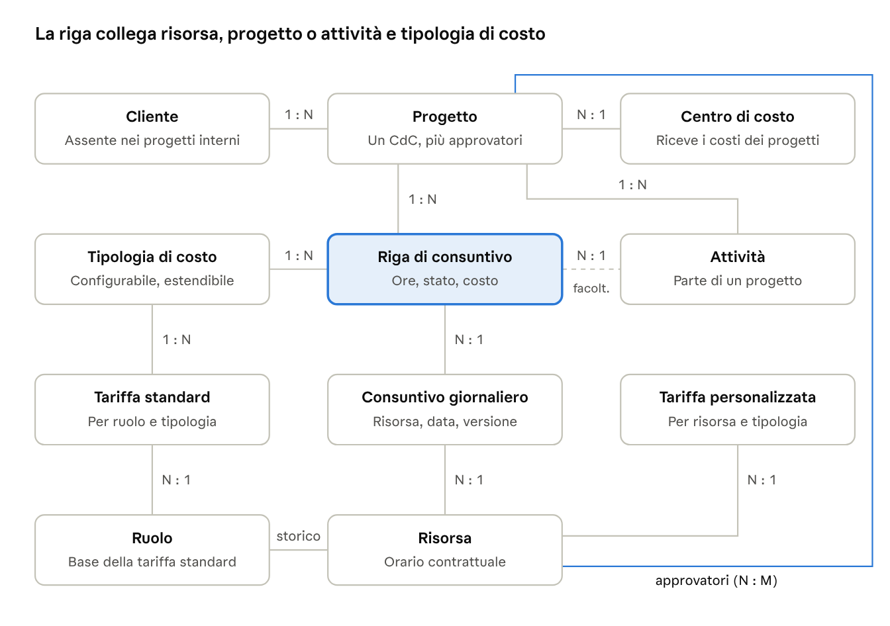
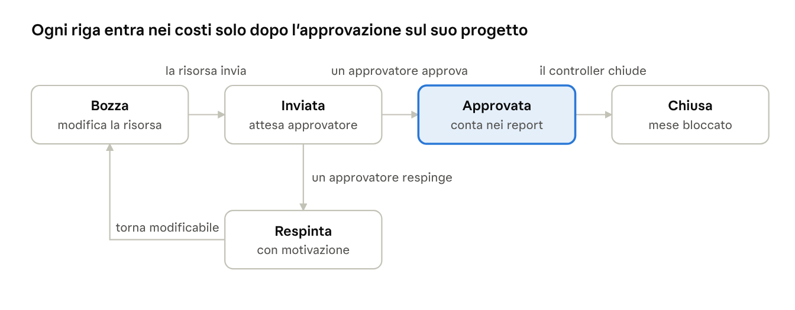

# ToolPM — Consuntivazione costi di progetto

16/11/2026 · Claudio Agasi

> Analisi della sezione **Consuntivazione** (nessun codice ancora scritto). Versione di lavoro con commenti: [documento su Claude](https://claude.ai/artifact/DaCYgfRoJpWhxxaWgQYMFt). Questo file è la copia salvata nel repository al 16/11/2026.

## Introduzione

La nuova sezione **Consuntivazione** di ToolPM raccoglie le ore lavorate da ogni risorsa, giorno per giorno e progetto per progetto, e ne ricava il costo del personale per progetto e per centro di costo. Il documento contiene l'analisi funzionale, l'analisi tecnica e due proposte di database (MongoDB e relazionale) messe a confronto. Non è stato ancora scritto codice.

*Revisione del 16/11/2026: aggiornata con le risposte ai punti aperti (tipologie di costo configurabili, tariffe standard per ruolo e personalizzate, più approvatori per progetto, nessun cambio di centro di costo) e con la dimensione aziendale di circa 200 dipendenti.*

*Revisione successiva: aggiunte le attività di progetto (si può consuntivare su un'attività invece che sul progetto), la vista del costo del singolo progetto, le procedure di esportazione per integrazioni future e i campi di ultimo salvataggio e utente su tutti i dati.*

**Perimetro.** Sono inclusi i costi delle circa 200 risorse interne (programmatori, analisti, designer UI/UX, project manager, team leader, architetti IT, sistemisti, tester e altri ruoli). Restano fuori, per ora: ferie, permessi e malattia; integrazione con paghe o HR; costi non legati al personale (licenze, hardware, trasferte); ricavi e fatturazione. Il modello è pensato per poterli aggiungere in seguito.

**Glossario**

| Termine | Significato |
| --- | --- |
| Risorsa | Persona che lavora sui progetti. È la stessa entità già usata dal Pianificatore. |
| Ruolo | Profilo professionale della risorsa (es. analista, tester). Determina la tariffa standard. |
| Progetto | Attività su cui si consuntivano ore, per un cliente oppure interna. Ha un solo centro di costo e uno o più approvatori. |
| Attività | Parte di un progetto (es. analisi, sviluppo, collaudo) su cui si può consuntivare al posto del progetto. Appartiene a un solo progetto. |
| Centro di costo (CdC) | Contenitore contabile che riceve i costi di uno o più progetti. |
| Approvatore | Persona che approva le ore consuntivate su un progetto e sulle sue attività. Un progetto può averne più d'uno. |
| Tipologia di costo | Tipo di ora con un proprio costo orario: ordinaria, straordinaria, straordinaria notturna, straordinaria festiva, più quelle che si vorranno aggiungere. |
| Tariffa standard | Costo orario per tipologia, valido per tutte le risorse di un ruolo in un intervallo di date. |
| Tariffa personalizzata | Costo orario per tipologia di una singola risorsa, in un intervallo di date. Prevale sulla tariffa standard. |
| Consuntivo | Ore dichiarate da una risorsa in una giornata, divise in righe per progetto (o attività) e tipologia di costo. |
| Costo consuntivato | Ore × tariffa applicabile alla risorsa in quella data, per quella tipologia. Alimenta attività (se presente), progetto e centro di costo. |

## Analisi funzionale

Ogni giorno la risorsa dichiara quante ore ha lavorato, su quali progetti o attività di progetto e con quale tipologia di costo. Il sistema valorizza ogni ora con la tariffa applicabile alla risorsa in quella data: quella personalizzata se c'è, altrimenti quella standard del suo ruolo. Ogni approvatore approva le righe dei propri progetti. I costi approvati si vedono a tre livelli: per attività, per singolo progetto e per centro di costo. Il costo di una riga su un'attività alimenta l'attività, il progetto a cui appartiene e il centro di costo di quel progetto.



La riga di consuntivo appartiene alla giornata di una risorsa, punta sempre a un progetto e, se la risorsa ha scelto un'attività, anche all'attività (linea tratteggiata, facoltativa). Da progetto e attività il costo risale al centro di costo. La tariffa si cerca prima tra quelle personalizzate della risorsa, poi tra quelle standard del suo ruolo. La linea blu collega i progetti ai loro approvatori, che sono risorse.

### Decisioni prese

| Tema | Decisione |
| --- | --- |
| Tipologie di costo | Configurabili da chi censisce i costi. Si parte da ordinaria, straordinaria, straordinaria notturna, straordinaria festiva; se ne possono aggiungere altre (es. una straordinaria notturna festiva con tariffa propria). Il sistema non decide quale tipologia si applica: la sceglie la risorsa. |
| Tariffe | Standard per ruolo; in più, tariffa personalizzata per la singola risorsa, che prevale sulla standard. |
| Progetto e centro di costo | Un progetto ha un solo centro di costo, che non cambia nel tempo e non si ripartisce. |
| Attività | Un progetto può avere attività. Si consuntiva sul progetto oppure su una sua attività; il costo di un'attività alimenta il suo progetto e il centro di costo del progetto. |
| Visibilità dei costi | Oltre al totale per centro di costo, si vede il costo del singolo progetto e, al suo interno, il dettaglio per attività. |
| Approvazione | Ogni progetto ha uno o più approvatori; ciascuno approva le ore consuntivate sui progetti di cui è approvatore, comprese quelle sulle loro attività. |
| Ferie, permessi, malattia | Esclusi per ora; possibile estensione futura. |
| Paghe e HR | Nessuna integrazione per ora; possibile estensione futura tramite procedure di esportazione. |
| Dimensione | Circa 200 dipendenti. |

### Attori

| Attore | Cosa fa |
| --- | --- |
| Risorsa | Inserisce e invia il proprio consuntivo. Vede solo le proprie ore, non le tariffe né i costi. |
| Approvatore di progetto | Approva o respinge le righe consuntivate sui progetti di cui è approvatore. Vede ore e costi di quei progetti. |
| Controller / amministrazione | Gestisce centri di costo, tipologie di costo, tariffe standard e personalizzate. Chiude i periodi. Vede tutti i costi. |
| Amministratore di sistema | Gestisce utenti, ruoli applicativi e anagrafiche comuni. |

### Requisiti funzionali

**Anagrafiche**

1. **RF-01 Clienti e progetti.** Codice univoco, descrizione, cliente (facoltativo per i progetti interni), date di inizio e fine, stato (attivo, sospeso, chiuso), centro di costo, uno o più approvatori. Il centro di costo non si può cambiare dopo il primo consuntivo. Il Pianificatore userà la stessa anagrafica al posto del testo libero di oggi.
2. **RF-02 Centri di costo.** Codice, descrizione, stato. Un centro di costo riceve i costi di uno o più progetti.
3. **RF-03 Risorse e ruoli.** Si riusa l'anagrafica risorse del Pianificatore, aggiungendo matricola, utente di accesso, date di ingresso e uscita, orario contrattuale giornaliero e ruolo. Il ruolo ha uno storico con data di decorrenza, perché da esso dipende la tariffa standard.
4. **RF-04 Tipologie di costo.** Anagrafica configurabile: codice, descrizione, ordine di visualizzazione, categoria (ordinaria o straordinaria), attiva sì/no. Una tipologia usata non si cancella, si disattiva.
5. **RF-05 Tariffe standard per ruolo.** Per ogni ruolo e tipologia di costo, un costo orario con data di inizio validità (e una di fine facoltativa).
6. **RF-06 Tariffe personalizzate.** Per una singola risorsa e una o più tipologie, un costo orario con validità. Prevale sulla tariffa standard del ruolo.

**Consuntivazione**

7. **RF-07 Consuntivo giornaliero.** La risorsa sceglie una data e inserisce una o più righe: progetto oppure attività di un progetto, tipologia di costo, ore, nota facoltativa. Nella stessa giornata può lavorare su più progetti e attività, e con più tipologie sulla stessa voce.
8. **RF-08 Vista settimanale.** Griglia progetti e attività × giorni con totali per riga e per giorno. Propone i progetti su cui la risorsa è allocata nel Pianificatore in quel mese.
9. **RF-09 Copia.** Copia del giorno o della settimana precedente come bozza.
10. **RF-10 Invio.** La risorsa invia una o più giornate: tutte le righe passano in attesa di approvazione.
11. **RF-11 Approvazione per progetto.** Ogni approvatore vede, in un elenco, le righe inviate sui propri progetti e le approva o respinge, anche in blocco, con motivazione per il rifiuto. Le righe della stessa giornata su progetti diversi seguono strade indipendenti. Le righe respinte tornano modificabili dalla risorsa.
12. **RF-12 Chiusura del periodo.** Il controller chiude un mese: le righe del mese non sono più modificabili, salvo riapertura motivata.

**Costi e report**

13. **RF-13 Calcolo del costo.** Per ogni riga: costo = ore × tariffa applicabile alla risorsa, per quella tipologia, in quella data (vedi sotto).
14. **RF-14 Costo per progetto.** Scheda costi del singolo progetto: ore e costo totale in un periodo e dall'inizio del progetto, con dettaglio per attività, risorsa, ruolo, tipologia di costo e mese. Le ore consuntivate direttamente sul progetto compaiono come voce "senza attività".
15. **RF-15 Costo per centro di costo.** Totale dei progetti associati, con dettaglio per progetto.
16. **RF-16 Pianificato e consuntivato.** Confronto tra la percentuale di allocazione del Pianificatore e le ore consuntivate, per risorsa, progetto e mese.
17. **RF-17 Esportazione.** Excel/CSV dei report e delle righe di dettaglio.
18. **RF-18 Ricalcolo.** Dopo una correzione retroattiva di una tariffa, il sistema mostra le righe interessate e ne ricalcola il costo su conferma del controller, tenendo traccia della modifica.

**Attività di progetto**

19. **RF-19 Anagrafica attività.** Per ogni progetto, un elenco di attività: codice (univoco nel progetto), descrizione, date di inizio e fine facoltative, stato (attiva, chiusa). Un'attività appartiene a un solo progetto e non si sposta su un altro dopo il primo consuntivo.
20. **RF-20 Consuntivazione su attività.** In ogni riga la risorsa sceglie il progetto oppure una sua attività. Scegliendo l'attività, il progetto è implicito.
21. **RF-21 Ribaltamento dei costi.** Il costo di una riga su un'attività si somma all'attività, al progetto a cui l'attività appartiene e al centro di costo di quel progetto, una sola volta per livello.
22. **RF-22 Costo per attività.** Ore e costo per attività in un periodo, dentro la scheda del progetto e nei report, con dettaglio per risorsa e tipologia di costo.
23. **RF-23 Approvazione delle attività.** Le righe su un'attività le approvano gli approvatori del progetto a cui l'attività appartiene.

### Calcolo del costo

La tariffa di una riga si cerca in quest'ordine, per la tipologia della riga e alla data della riga:

1. tariffa personalizzata della risorsa;
2. altrimenti tariffa standard del ruolo che la risorsa aveva in quella data;
3. altrimenti la riga resta "da valorizzare" e il controller riceve un avviso.

```latex
\text{costo}_{\text{riga}} = \text{ore} \times \text{tariffa}(\text{risorsa}, \text{tipologia}, \text{data})
```

```latex
\text{costo}_{\text{attività}} = \sum_{\text{righe approvate sull'attività}} \text{costo}_{\text{riga}} \qquad \text{costo}_{\text{progetto}} = \sum_{\text{righe approvate sul progetto senza attività}} \text{costo}_{\text{riga}} + \sum_{\text{attività del progetto}} \text{costo}_{\text{attività}}
```

```latex
\text{costo}_{\text{CdC}} = \sum_{\text{progetti del CdC}} \text{costo}_{\text{progetto}}
```

Esempio con valori ipotetici. Il ruolo "Sviluppatore senior" ha tariffe standard di 30, 39, 45 e 51 €/h per le quattro tipologie iniziali; la risorsa ha una tariffa personalizzata solo per l'ordinaria, a 32 €/h. In una giornata consuntiva 6 ore ordinarie sull'attività "Sviluppo" del progetto A, 2 ore straordinarie direttamente sul progetto A e 2 ore ordinarie sull'attività "Collaudo" del progetto B.

| Progetto | Attività | Tipologia | Ore | Tariffa usata | €/h | Costo (€) |
| --- | --- | --- | --- | --- | --- | --- |
| A | Sviluppo | Ordinaria | 6 | Personalizzata | 32 | 192 |
| A | — (sul progetto) | Straordinaria | 2 | Standard del ruolo | 39 | 78 |
| B | Collaudo | Ordinaria | 2 | Personalizzata | 32 | 64 |
| **Totale** |  |  | **10** |  |  | **334** |

Quel giorno l'attività "Sviluppo" costa 192 € e il progetto A 270 €: 192 € dall'attività più 78 € consuntivati direttamente sul progetto. Il progetto B costa 64 €, tutti dall'attività "Collaudo". Il centro di costo di A riceve 270 €, quello di B 64 €. Le righe di A e di B possono essere approvate da persone diverse e in momenti diversi; ciascuna entra nei report solo dopo la propria approvazione.

### Regole di business

- Le ore si inseriscono a passi di 15 minuti; ogni riga ha almeno 0,25 h.
- Il totale di una giornata non supera 24 ore.
- Se le ore delle tipologie di categoria "ordinaria" superano l'orario contrattuale della risorsa, il sistema lo segnala ma non blocca.
- Il sistema non verifica quale tipologia sia corretta per l'orario o per il giorno (notturno, festivo): la scelta spetta alla risorsa e la verifica all'approvatore.
- Ogni riga è su un progetto oppure su una sua attività, mai su entrambi in modo indipendente: se c'è l'attività, il progetto della riga è sempre quello dell'attività.
- Si consuntiva solo su progetti e attività attivi alla data, con tipologie attive, tra data di ingresso e di uscita della risorsa.
- Il costo di una riga si conta una sola volta per livello: nell'attività (se c'è), nel progetto e nel centro di costo. I totali di progetto non sommano due volte le righe delle attività.
- Il costo calcolato si memorizza sulla riga con la tariffa usata e la sua provenienza (personalizzata o standard): i report non cambiano se una tariffa cambia in seguito, salvo ricalcolo esplicito (RF-18).
- Una riga approvata non si modifica più; per correggerla l'approvatore deve prima respingerla.
- Ogni modifica a righe approvate, tariffe, tipologie, attività e approvatori viene registrata (chi, quando, valore prima e dopo).

### Stati di una riga

L'approvazione avviene per progetto, quindi lo stato appartiene alla singola riga. Lo stato della giornata è un riepilogo (es. "3 righe approvate su 4").



Le righe della stessa giornata su progetti diversi passano per questi stati in modo indipendente. Un mese chiuso si può riaprire solo dal controller, con motivazione registrata nello storico.

### Requisiti non funzionali

- **Riservatezza.** Tariffe e costi li vedono solo il controller e, per i propri progetti, gli approvatori. Serve un'autenticazione con utenti e ruoli, che oggi ToolPM non ha.
- **Volumi.** Con 200 risorse, circa 220 giorni lavorativi e 3 righe al giorno: circa 44.000 giornate e 130.000 righe l'anno, 1,3 milioni in dieci anni.
- **Prestazioni.** Report annuali su tutte le risorse in pochi secondi; inserimento di una settimana tipica in meno di due minuti.
- **Concorrenza.** Più approvatori possono agire nello stesso momento su righe della stessa giornata, anche mentre la risorsa ne modifica altre.
- **Precisione.** Importi in centesimi interi o decimali esatti, mai virgola mobile.
- **Tracciabilità.** Storico delle modifiche conservato per la durata prevista dalle regole amministrative aziendali.

### Punti ancora aperti

Le risposte hanno chiuso tutti i punti precedenti. Restano alcuni dettagli, per ciascuno dei quali il documento adotta l'ipotesi indicata.

- [ ] Con più approvatori sullo stesso progetto basta l'approvazione di uno solo? *Ipotesi: sì.*
- [ ] La tariffa personalizzata prevale sempre sulla standard, o si usa solo quando la risorsa non ha un ruolo con tariffe standard? *Ipotesi: prevale sempre, per le tipologie che contiene.*
- [ ] Una tariffa personalizzata che copre solo alcune tipologie si integra con le standard per le altre? *Ipotesi: sì, come nell'esempio.*
- [ ] Una tipologia di costo aggiunta in futuro senza tariffe definite: le righe restano "da valorizzare"? *Ipotesi: sì.*
- [ ] Le attività possono avere sotto-attività? *Ipotesi: no, un solo livello sotto il progetto.*
- [ ] Un progetto con attività può ricevere ore anche direttamente, o va imposto di consuntivare solo sulle attività? *Ipotesi: entrambe le cose sono possibili, con un'impostazione per progetto "solo su attività", disattivata di default.*
- [ ] Serve un budget (ore o importo) per progetto o per attività, da confrontare con il consuntivato? *Ipotesi: non ora; il modello può accoglierlo in seguito.*

## Analisi tecnica

La Consuntivazione diventa la seconda sezione di ToolPM, con la stessa struttura del Pianificatore: cartella `consuntivazione/` nel backend e nel frontend, API sotto `/api/consuntivazione`, pagine sotto `/toolpm/consuntivazione`. Prima servono due interventi trasversali: un modulo di **dati comuni** (risorse, ruoli, clienti, progetti, centri di costo) condiviso tra le sezioni, e l'**autenticazione con ruoli applicativi**.

### Moduli del backend (NestJS)

| Modulo | Cartella | Prefisso API | Contenuto |
| --- | --- | --- | --- |
| Comuni | `src/comuni/` | `/api/comuni` | Risorse (spostate dal Pianificatore) con storico dei ruoli, ruoli professionali, clienti, progetti con approvatori e attività, centri di costo |
| Auth | `src/auth/` | `/api/auth` | Login, token JWT, guard per ruolo applicativo, utente corrente |
| Pianificatore | `src/pianificatore/` | `/api/pianificatore` | Invariato; legge risorse e progetti dal modulo Comuni |
| Consuntivazione | `src/consuntivazione/` | `/api/consuntivazione` | Tipologie di costo, tariffe standard e personalizzate, consuntivi, approvazioni, chiusura periodi, calcolo costi, report |
| Audit | `src/audit/` | — | Interceptor che registra le modifiche ai dati sensibili |

I moduli si registrano come oggi con `RouterModule` in `app.module.ts`. Lo spostamento delle risorse in Comuni cambia `/api/pianificatore/risorse` in `/api/comuni/risorse`: il frontend del Pianificatore va aggiornato nello stesso rilascio.

### API principali

| Metodo | Percorso | Chi | Descrizione |
| --- | --- | --- | --- |
| GET / POST / PUT | `/api/comuni/progetti`, `/clienti`, `/centri-costo`, `/ruoli` | Controller, admin | Anagrafiche; il centro di costo di un progetto è bloccato dopo il primo consuntivo |
| PUT | `/api/comuni/progetti/:id/approvatori` | Controller, admin | Elenco degli approvatori del progetto |
| GET / POST / PUT | `/api/comuni/progetti/:id/attivita` | Controller, approvatore del progetto | Attività del progetto; il progetto di un'attività è bloccato dopo il primo consuntivo |
| GET / POST / PUT | `/api/consuntivazione/tipologie-costo` | Controller | Tipologie configurabili; disattivazione invece di cancellazione |
| GET / POST / PUT | `/api/consuntivazione/tariffe-standard?ruolo=` | Controller | Tariffe per ruolo e tipologia, con validità |
| GET / POST / PUT | `/api/consuntivazione/risorse/:id/tariffe-personalizzate` | Controller | Tariffe della singola risorsa, con validità |
| GET | `/api/consuntivazione/risorse/:id/tariffe-applicabili?data=` | Controller | Risultato della risoluzione per ogni tipologia, con la provenienza |
| GET | `/api/consuntivazione/consuntivi?da=&a=` | Risorsa (proprie), controller | Consuntivi del periodo |
| PUT | `/api/consuntivazione/consuntivi/:data` | Risorsa | Crea o aggiorna le righe in bozza o respinte della giornata; ogni riga indica il progetto o l'attività |
| POST | `/api/consuntivazione/consuntivi/invio` | Risorsa | Invia un insieme di giornate |
| GET | `/api/consuntivazione/approvazioni?progetto=&attivita=&stato=inviata` | Approvatore | Righe da approvare sui propri progetti e sulle loro attività |
| POST | `/api/consuntivazione/approvazioni` | Approvatore | Approva o respinge un elenco di righe, con motivazione |
| POST | `/api/consuntivazione/periodi/:mese/chiudi`, `/riapri` | Controller | Chiusura del mese |
| GET | `/api/consuntivazione/report/progetti/:id?da=&a=` | Approvatore del progetto, controller | Scheda costi del progetto: totale, dettaglio per attività (più la voce "senza attività"), risorsa, tipologia, mese |
| GET | `/api/consuntivazione/report/costi?raggruppa=cdc\|progetto\|attivita\|risorsa\|ruolo\|tipologia&da&a` | Approvatore (propri progetti), controller | Totali ore e costi, anche annidati (es. centro di costo → progetto → attività) |
| GET | `/api/consuntivazione/report/pianificato-vs-consuntivato?mese=AAAAMM` | Approvatore, controller | Confronto con il Pianificatore |
| POST | `/api/consuntivazione/ricalcolo` | Controller | Anteprima e applicazione del ricalcolo dopo una correzione di tariffa |

Le risposte per la risorsa non contengono mai tariffe né importi; quelle per l'approvatore solo i progetti di cui è approvatore. I filtri stanno nel backend.

### Pagine del frontend (Angular)

| Percorso | Pagina | Chi |
| --- | --- | --- |
| `/toolpm/consuntivazione/settimana` | Il mio consuntivo: griglia progetti e attività × giorni, stato di ogni riga, invio | Risorsa |
| `/toolpm/consuntivazione/approvazioni` | Righe da approvare, filtrabili per progetto, attività, risorsa e periodo; approvazione in blocco | Approvatore |
| `/toolpm/consuntivazione/progetti/:id` | Scheda costi del progetto: totale, andamento mensile, dettaglio per attività, risorsa e tipologia | Approvatore del progetto, controller |
| `/toolpm/consuntivazione/costi` | Report costi per centro di costo, progetto e attività, con esportazione | Approvatore, controller |
| `/toolpm/consuntivazione/tipologie` | Tipologie di costo | Controller |
| `/toolpm/consuntivazione/tariffe` | Tariffe standard per ruolo e personalizzate per risorsa, con storico | Controller |
| `/toolpm/consuntivazione/periodi` | Stato e chiusura dei mesi | Controller |
| `/toolpm/comuni/...` | Progetti (con approvatori e attività), clienti, centri di costo, ruoli | Controller, admin |

### Risoluzione della tariffa e calcolo del costo

1. Al salvataggio di una giornata, il servizio carica in una volta il ruolo della risorsa alla data, le sue tariffe personalizzate valide alla data e le tariffe standard di quel ruolo valide alla data.
2. Per ogni riga sceglie la tariffa della tipologia: personalizzata, altrimenti standard, altrimenti nessuna.
3. Calcola `costoCentesimi = round(minuti × tariffaCentesimiOra / 60)`.
4. Salva sulla riga minuti, tariffa usata, provenienza (personalizzata o standard) e riferimento alla tariffa: è la "fotografia" che rende stabili i report.
5. Se la riga è su un'attività, imposta il progetto della riga uguale a quello dell'attività. Copia sulla riga anche il centro di costo del progetto. Non serve per la storicizzazione, perché il centro non cambia; serve a rendere i report per centro di costo più semplici e veloci. Allo stesso modo progetto e attività sono entrambi sulla riga, così i totali per attività, progetto e centro di costo si calcolano con un solo raggruppamento, senza doppi conteggi.
6. Senza tariffa, il costo resta vuoto e la riga compare tra quelle "da valorizzare".
7. I report sommano i costi memorizzati delle righe approvate, senza ricalcolarli.
8. Il ricalcolo (RF-18) ripete i passi 1–4 sulle righe di un intervallo, solo su richiesta del controller e con registrazione nello storico.

Le tariffe sono una lista di voci per tipologia, non campi fissi: una nuova tipologia si aggiunge senza modificare il codice né lo schema. Ore e importi sono interi (**minuti** e **centesimi di euro**); la conversione in ore e euro avviene solo nella visualizzazione.

### Validazioni e concorrenza

- DTO con `class-validator`: data ISO, minuti multipli di 15, tipologia, progetto e attività esistenti e attivi.
- Ogni riga ha il progetto oppure l'attività; se arriva un'attività, il progetto lo ricava il backend (un progetto diverso inviato dal client viene rifiutato).
- Se il progetto è impostato "solo su attività", le righe senza attività vengono rifiutate.
- Regole della giornata nel servizio: totale ≤ 24 h, avviso sulle ore ordinarie oltre l'orario contrattuale, periodo non chiuso, righe approvate non modificabili.
- Una sola giornata per risorsa e data (vincolo di unicità).
- Tariffe: nessuna sovrapposizione di periodi per la stessa combinazione ruolo + tipologia o risorsa + tipologia.
- Approvazione: il backend verifica che l'utente sia approvatore del progetto di ogni riga, anche quando la riga è su un'attività.
- Concorrenza: approvazioni e modifiche aggiornano solo le righe interessate; un numero di versione sulla giornata impedisce che un salvataggio della risorsa sovrascriva un'approvazione avvenuta nel frattempo.

### Sicurezza

- Autenticazione con utente e password (o in seguito con il sistema aziendale, es. Microsoft Entra ID) e token JWT con scadenza.
- Ruoli applicativi: `risorsa`, `approvatore` (derivato dall'essere approvatore di almeno un progetto), `controller`, `admin`. Una risorsa è legata a un utente.
- Guard NestJS su ogni endpoint; i filtri sui dati (le mie ore, i miei progetti) sono applicati nelle query.
- Le API del Pianificatore, oggi aperte, vanno protette nello stesso rilascio.

### Tracciamento dei salvataggi

Ogni documento salvato in MongoDB, di qualsiasi collection e sezione (Pianificatore compreso), porta sempre la data dell'ultimo salvataggio e l'utente che l'ha fatto, insieme a data e utente di creazione:

| Campo | Contenuto |
| --- | --- |
| `creatoIl` | Data e ora di creazione (UTC) |
| `creatoDa` | Id dell'utente che ha creato il documento |
| `modificatoIl` | Data e ora dell'ultimo salvataggio (UTC) |
| `modificatoDa` | Id dell'utente che ha fatto l'ultimo salvataggio |

- I campi si valorizzano in automatico, senza che ogni servizio debba ricordarsene: un plugin Mongoose globale li imposta su ogni `save`, `insert` e `update`, leggendo l'utente corrente da un contesto di richiesta (`AsyncLocalStorage`) popolato dalla guard di autenticazione.
- Le operazioni senza utente (procedure pianificate, importazioni, migrazioni) usano un utente tecnico riconoscibile, es. `sistema:export` o `sistema:migrazione`.
- Le righe incorporate nei consuntivi hanno gli stessi due campi `modificatoIl` e `modificatoDa`, perché risorsa e approvatori modificano righe diverse della stessa giornata.
- Le operazioni massive dirette sul database (`updateMany`, `bulkWrite`) passano per lo stesso plugin; uno script di controllo segnala eventuali documenti privi dei campi.
- I documenti già esistenti del Pianificatore ricevono i campi con una migrazione iniziale (`modificatoDa: "sistema:migrazione"`).
- Questi campi indicano solo l'ultimo salvataggio; lo storico completo dei valori precedenti resta nella collection `audit_log`.
- `modificatoIl` è anche il riferimento per le estrazioni incrementali verso i sistemi esterni.

### Test

- Test unitari (Vitest) sulla risoluzione della tariffa: personalizzata parziale, cambio di ruolo a metà mese, cambio di tariffa, tariffa mancante, nuova tipologia, arrotondamenti.
- Test dei totali: righe su attività e direttamente sul progetto nella stessa giornata, verifica che attività + "senza attività" = progetto e che la somma dei progetti = centro di costo.
- Test degli stati delle righe e dell'approvazione con più approvatori e progetti diversi nella stessa giornata.
- Test di concorrenza (approvazione e modifica contemporanee) e dei permessi per ogni ruolo.

### Piano di rilascio proposto

1. **Fase 1 — Fondamenta.** Autenticazione e ruoli; modulo Comuni con progetti, approvatori, clienti, centri di costo e ruoli; migrazione delle risorse e dei progetti del Pianificatore (oggi testi liberi) verso le nuove anagrafiche.
2. **Fase 2 — Consuntivazione.** Tipologie di costo, tariffe standard e personalizzate, consuntivo giornaliero e settimanale, calcolo e memorizzazione dei costi.
3. **Fase 3 — Controllo.** Invio, approvazione per progetto, chiusura dei periodi, storico delle modifiche.
4. **Fase 4 — Report.** Costi per progetto e centro di costo, pianificato contro consuntivato, esportazioni.

## Integrazioni future con contabilità, paghe ed ERP

Le integrazioni con contabilità, paghe ed ERP non richiedono un database relazionale. Si realizzano con procedure pianificate, eseguite una volta al giorno o alla settimana, che leggono i dati da MongoDB, li trasformano nel formato richiesto e li inviano al sistema di destinazione. I dati in MongoDB vengono solo letti: l'unica scrittura è nel registro delle esportazioni. Oggi non servono, ma il modello dei dati è già predisposto.


La procedura legge da MongoDB, trasforma e invia ai sistemi esterni; l'unica scrittura su MongoDB è la registrazione dell'invio nella collection `esportazioni`.

### Come funziona un'esecuzione

1. **Estrazione.** Legge le righe approvate o dei mesi chiusi modificate dopo l'ultimo invio riuscito verso quella destinazione, usando `modificatoIl` e il registro `esportazioni`.
2. **Trasformazione.** Raggruppa i dati come li vuole la destinazione (es. ore per matricola e tipologia, costi per centro di costo e mese) e traduce i codici di ToolPM in quelli esterni con la tabella `corrispondenze_codici`.
3. **Invio.** Produce un file (CSV, XML o tracciato fisso) da depositare in una cartella condivisa o su SFTP, oppure chiama le API del sistema esterno.
4. **Registrazione.** Scrive in `esportazioni` destinazione, periodo, numero di record, totali di controllo, esito e file prodotto.
5. **Avviso.** In caso di errore avvisa il controller, che può rilanciare l'esecuzione a mano.

### Esempi di esportazione

I contenuti e i formati effettivi andranno concordati con i fornitori dei sistemi di destinazione; la tabella mostra un punto di partenza.

| Destinazione | Contenuto | Frequenza | Dati inclusi |
| --- | --- | --- | --- |
| Paghe | Ore per matricola, tipologia di costo e giorno (in particolare gli straordinari) | Mensile, dopo la chiusura del mese | Solo mesi chiusi |
| Contabilità / controllo di gestione | Costi per centro di costo, progetto e mese | Mensile, dopo la chiusura del mese | Solo mesi chiusi |
| ERP | Ore e costi per commessa e sottocommessa (progetto e attività) | Giornaliera o settimanale | Righe approvate |
| Database di analisi (es. per Power BI) | Copia delle righe e delle anagrafiche in tabelle relazionali | Giornaliera | Righe approvate e anagrafiche |

### Regole

- **Solo dati consolidati.** Si esportano righe approvate o mesi chiusi, mai bozze o righe in attesa.
- **Incrementale e ripetibile.** Ogni esecuzione riprende da dove si era fermata l'ultima riuscita; rieseguire lo stesso periodo produce lo stesso risultato.
- **Rettifiche.** Se un mese già inviato viene riaperto e corretto, la procedura invia la differenza o il mese completo da sostituire, secondo quanto accetta la destinazione, e lo segna nel registro.
- **Totali di controllo.** Ogni invio riporta numero di righe, ore e importo totali, da confrontare con i report di ToolPM.
- **Sicurezza.** Credenziali dei sistemi esterni in variabili d'ambiente o in un gestore di segreti, mai nel codice; trasferimenti cifrati (SFTP, HTTPS).

### Componenti

| Componente | Descrizione |
| --- | --- |
| Modulo `src/integrazioni/` | Un connettore per destinazione con la stessa struttura (estrai, trasforma, invia); attività pianificate con `@nestjs/schedule` |
| Esecuzione | Nel backend di ToolPM o, se si preferisce isolarle, in un container dedicato nel `docker-compose.yml` che usa lo stesso codice |
| Collection `esportazioni` | Registro degli invii: destinazione, periodo, data, esito, record, totali, file, utente o `sistema:export` |
| Collection `corrispondenze_codici` | Per ogni entità (progetto, centro di costo, tipologia, risorsa) e sistema esterno, il codice da usare |
| Pagina `/toolpm/consuntivazione/integrazioni` | Per il controller: stato degli invii, rilancio manuale, gestione delle corrispondenze dei codici |

Nel piano di rilascio le integrazioni sono una **fase 5** facoltativa, da avviare quando si conosceranno i sistemi di destinazione. Quello che serve già dalla fase 1 sono i campi `modificatoIl` / `modificatoDa`, la chiusura dei periodi e i codici stabili di progetti, centri di costo e risorse.

## Proposta database MongoDB

Nel database `toolpm` si aggiungono tredici collection, oltre a `risorse` che esiste già. Il consuntivo resta **un documento per risorsa e giornata**, con le righe incorporate; ogni riga ha ora il proprio stato di approvazione. Le tariffe sono **un documento per tipologia e periodo**, così una nuova tipologia non cambia lo schema.

**Tutti** i documenti di tutte le collection, comprese quelle del Pianificatore, hanno i campi `creatoIl`, `creatoDa`, `modificatoIl` e `modificatoDa`, valorizzati in automatico a ogni salvataggio (vedi "Tracciamento dei salvataggi" nell'analisi tecnica). Le righe incorporate nei consuntivi hanno a loro volta `modificatoIl` e `modificatoDa`.

| Collection | Un documento = | Note |
| --- | --- | --- |
| `risorse` | una persona | Esistente; si aggiungono `matricola`, `utenteId`, `dataIngresso`, `dataUscita`, `oreContrattualiGiorno` e `storicoRuoli` (ruolo + data di decorrenza) |
| `ruoli` | un ruolo professionale | Codice, descrizione |
| `clienti` | un cliente | Codice e ragione sociale |
| `centri_costo` | un centro di costo | Codice, descrizione, stato |
| `progetti` | un progetto | Cliente, centro di costo (fisso), `approvatoriIds`, `soloSuAttivita`, date, stato |
| `attivita` | un'attività di un progetto | `progettoId` (fisso dopo il primo consuntivo), codice univoco nel progetto, descrizione, date, stato |
| `tipologie_costo` | una tipologia | Codice, descrizione, ordine, categoria, attiva |
| `tariffe_standard` | costo orario di un ruolo per una tipologia in un periodo | Collection separata, accessibile solo al controller |
| `tariffe_personalizzate` | costo orario di una risorsa per una tipologia in un periodo | Come sopra |
| `consuntivi` | una risorsa in una giornata | Righe incorporate con progetto, attività facoltativa, stato, costo e tariffa "fotografati"; campo `versione` |
| `periodi` | un mese | Stato aperto/chiuso, chi e quando |
| `audit_log` | una modifica | Collection, id, utente, data, valori prima e dopo |
| `esportazioni` | un invio verso un sistema esterno | Destinazione, periodo, esito, record, totali di controllo, file (per le integrazioni future) |
| `corrispondenze_codici` | un codice esterno | Entità di ToolPM, sistema esterno, codice da usare (per le integrazioni future) |

### Documenti di esempio

`progetti`

```json
{
  "_id": { "$oid": "6740a1c2e1f0a1b2c3d4e501" },
  "codice": "TIMBUFE",
  "descrizione": "TIM — front end Business",
  "clienteId": { "$oid": "6740a1c2e1f0a1b2c3d4e401" },
  "centroCostoId": { "$oid": "6740a1c2e1f0a1b2c3d4e301" },
  "approvatoriIds": [ { "$oid": "6740a1c2e1f0a1b2c3d4e099" }, { "$oid": "6740a1c2e1f0a1b2c3d4e098" } ],
  "dataInizio": { "$date": "2027-01-01T00:00:00Z" },
  "dataFine": null,
  "stato": "attivo",
  "creatoIl": { "$date": "2026-12-15T10:20:00Z" },
  "creatoDa": { "$oid": "6740a1c2e1f0a1b2c3d4e0c1" },
  "modificatoIl": { "$date": "2027-01-03T08:45:00Z" },
  "modificatoDa": { "$oid": "6740a1c2e1f0a1b2c3d4e0c1" }
}
```

`attivita`

```json
{
  "_id": { "$oid": "6740a1c2e1f0a1b2c3d4eb01" },
  "progettoId": { "$oid": "6740a1c2e1f0a1b2c3d4e501" },
  "codice": "SVIL",
  "descrizione": "Sviluppo",
  "dataInizio": { "$date": "2027-01-01T00:00:00Z" },
  "dataFine": null,
  "stato": "attiva",
  "creatoIl": { "$date": "2026-12-15T10:30:00Z" },
  "creatoDa": { "$oid": "6740a1c2e1f0a1b2c3d4e099" },
  "modificatoIl": { "$date": "2026-12-15T10:30:00Z" },
  "modificatoDa": { "$oid": "6740a1c2e1f0a1b2c3d4e099" }
}
```

`tipologie_costo`

```json
{ "_id": { "$oid": "6740a1c2e1f0a1b2c3d4e801" }, "codice": "STRAORD_NOTTURNA", "descrizione": "Straordinaria notturna", "ordine": 3, "categoria": "straordinaria", "attiva": true,
  "creatoIl": { "$date": "2026-12-15T10:00:00Z" }, "creatoDa": { "$oid": "6740a1c2e1f0a1b2c3d4e0c1" },
  "modificatoIl": { "$date": "2026-12-15T10:00:00Z" }, "modificatoDa": { "$oid": "6740a1c2e1f0a1b2c3d4e0c1" } }
```

`tariffe_standard` e `tariffe_personalizzate` (importi in centesimi di euro all'ora)

```json
{ "ruoloId": { "$oid": "6740a1c2e1f0a1b2c3d4e201" }, "tipologiaId": { "$oid": "6740a1c2e1f0a1b2c3d4e802" },
  "validoDal": { "$date": "2027-01-01T00:00:00Z" }, "validoAl": null, "centesimiOra": 3900,
  "creatoIl": { "$date": "2026-12-16T09:00:00Z" }, "creatoDa": { "$oid": "6740a1c2e1f0a1b2c3d4e0c1" },
  "modificatoIl": { "$date": "2026-12-16T09:00:00Z" }, "modificatoDa": { "$oid": "6740a1c2e1f0a1b2c3d4e0c1" } }

{ "risorsaId": { "$oid": "6ae88b192fcc045f0ca48409" }, "tipologiaId": { "$oid": "6740a1c2e1f0a1b2c3d4e800" },
  "validoDal": { "$date": "2027-01-01T00:00:00Z" }, "validoAl": null, "centesimiOra": 3200,
  "creatoIl": { "$date": "2026-12-16T09:05:00Z" }, "creatoDa": { "$oid": "6740a1c2e1f0a1b2c3d4e0c1" },
  "modificatoIl": { "$date": "2026-12-16T09:05:00Z" }, "modificatoDa": { "$oid": "6740a1c2e1f0a1b2c3d4e0c1" } }
```

`consuntivi` (la giornata dell'esempio dell'analisi funzionale: le righe del progetto A, una sull'attività "Sviluppo" e una direttamente sul progetto, già approvate; quella sull'attività "Collaudo" del progetto B in attesa)

```json
{
  "_id": { "$oid": "6740a1c2e1f0a1b2c3d4e701" },
  "risorsaId": { "$oid": "6ae88b192fcc045f0ca48409" },
  "data": { "$date": "2027-01-12T00:00:00Z" },
  "mese": "202701",
  "versione": 4,
  "righe": [
    { "_id": { "$oid": "6740a1c2e1f0a1b2c3d4ea01" }, "progettoId": { "$oid": "6740a1c2e1f0a1b2c3d4e501" },
      "attivitaId": { "$oid": "6740a1c2e1f0a1b2c3d4eb01" },
      "centroCostoId": { "$oid": "6740a1c2e1f0a1b2c3d4e301" }, "tipologiaId": { "$oid": "6740a1c2e1f0a1b2c3d4e800" },
      "tipologiaCodice": "ORDINARIA", "minuti": 360, "fonteTariffa": "personalizzata", "tariffaCentesimiOra": 3200,
      "costoCentesimi": 19200, "stato": "approvata",
      "approvataDa": { "$oid": "6740a1c2e1f0a1b2c3d4e099" }, "approvataIl": { "$date": "2027-01-13T09:10:00Z" },
      "modificatoIl": { "$date": "2027-01-13T09:10:00Z" }, "modificatoDa": { "$oid": "6740a1c2e1f0a1b2c3d4e099" } },
    { "_id": { "$oid": "6740a1c2e1f0a1b2c3d4ea02" }, "progettoId": { "$oid": "6740a1c2e1f0a1b2c3d4e501" },
      "attivitaId": null,
      "centroCostoId": { "$oid": "6740a1c2e1f0a1b2c3d4e301" }, "tipologiaId": { "$oid": "6740a1c2e1f0a1b2c3d4e802" },
      "tipologiaCodice": "STRAORDINARIA", "minuti": 120, "fonteTariffa": "standard", "tariffaCentesimiOra": 3900,
      "costoCentesimi": 7800, "stato": "approvata",
      "approvataDa": { "$oid": "6740a1c2e1f0a1b2c3d4e099" }, "approvataIl": { "$date": "2027-01-13T09:10:00Z" },
      "modificatoIl": { "$date": "2027-01-13T09:10:00Z" }, "modificatoDa": { "$oid": "6740a1c2e1f0a1b2c3d4e099" } },
    { "_id": { "$oid": "6740a1c2e1f0a1b2c3d4ea03" }, "progettoId": { "$oid": "6740a1c2e1f0a1b2c3d4e502" },
      "attivitaId": { "$oid": "6740a1c2e1f0a1b2c3d4eb02" },
      "centroCostoId": { "$oid": "6740a1c2e1f0a1b2c3d4e302" }, "tipologiaId": { "$oid": "6740a1c2e1f0a1b2c3d4e800" },
      "tipologiaCodice": "ORDINARIA", "minuti": 120, "fonteTariffa": "personalizzata", "tariffaCentesimiOra": 3200,
      "costoCentesimi": 6400, "stato": "inviata",
      "modificatoIl": { "$date": "2027-01-12T18:05:00Z" }, "modificatoDa": { "$oid": "6740a1c2e1f0a1b2c3d4e0a1" } }
  ],
  "creatoIl": { "$date": "2027-01-12T17:40:00Z" },
  "creatoDa": { "$oid": "6740a1c2e1f0a1b2c3d4e0a1" },
  "modificatoIl": { "$date": "2027-01-13T09:10:00Z" },
  "modificatoDa": { "$oid": "6740a1c2e1f0a1b2c3d4e099" }
}
```

### Indici

| Collection | Indice | Scopo |
| --- | --- | --- |
| `consuntivi` | `{ risorsaId: 1, data: 1 }` unico | Una sola giornata per risorsa; lettura della settimana |
| `consuntivi` | `{ "righe.progettoId": 1, "righe.stato": 1, data: 1 }` | Righe da approvare e scheda costi del progetto |
| `consuntivi` | `{ "righe.attivitaId": 1, data: 1 }` | Costi per attività |
| `consuntivi` | `{ "righe.centroCostoId": 1, data: 1 }` | Report per centro di costo |
| `consuntivi` | `{ mese: 1 }` | Chiusura del periodo |
| `consuntivi` | `{ modificatoIl: 1 }` | Estrazioni incrementali verso i sistemi esterni |
| `attivita` | `{ progettoId: 1, codice: 1 }` unico | Attività di un progetto, codice univoco nel progetto |
| `tariffe_personalizzate` | `{ risorsaId: 1, tipologiaId: 1, validoDal: -1 }` | Tariffa della risorsa valida in una data |
| `tariffe_standard` | `{ ruoloId: 1, tipologiaId: 1, validoDal: -1 }` | Tariffa del ruolo valida in una data |
| `progetti` | `{ codice: 1 }` unico; `{ approvatoriIds: 1 }`; `{ centroCostoId: 1 }` | Ricerca, progetti di un approvatore, progetti di un centro |
| `tipologie_costo` | `{ codice: 1 }` unico | Ricerca per codice |
| `esportazioni` | `{ destinazione: 1, periodo: 1 }` | Ultimo invio per destinazione e periodo |
| `corrispondenze_codici` | `{ sistema: 1, entita: 1, idToolPM: 1 }` unico | Traduzione dei codici verso i sistemi esterni |

### Approvazione di righe

L'approvatore aggiorna solo le righe dei propri progetti, senza toccare le altre righe della stessa giornata:

```javascript
db.consuntivi.updateMany(
  { "righe._id": { $in: righeDaApprovare } },
  { $set: { "righe.$[r].stato": "approvata", "righe.$[r].approvataDa": utenteId, "righe.$[r].approvataIl": new Date() },
    $inc: { versione: 1 } },
  { arrayFilters: [ { "r._id": { $in: righeDaApprovare }, "r.stato": "inviata",
                      "r.progettoId": { $in: progettiDellApprovatore } } ] }
)
```

L'incremento di `versione` fa fallire un salvataggio della risorsa basato su una copia precedente: la pagina la ricarica e mostra lo stato aggiornato.

### Aggregazione dei costi

Costo e ore di ogni progetto in un mese, solo righe approvate, con il dettaglio per attività (le righe senza attività finiscono nella voce con attività nulla):

```javascript
db.consuntivi.aggregate([
  { $match: { data: { $gte: ISODate("2027-01-01"), $lt: ISODate("2027-02-01") } } },
  { $unwind: "$righe" },
  { $match: { "righe.stato": { $in: ["approvata", "chiusa"] } } },
  // 1. totali per progetto e attività
  { $group: { _id: { progetto: "$righe.progettoId", attivita: "$righe.attivitaId" },
              centroCosto: { $first: "$righe.centroCostoId" },
              minuti: { $sum: "$righe.minuti" },
              costoCentesimi: { $sum: "$righe.costoCentesimi" } } },
  // 2. totale del progetto con l'elenco delle attività
  { $group: { _id: "$_id.progetto",
              centroCosto: { $first: "$centroCosto" },
              minuti: { $sum: "$minuti" },
              costoCentesimi: { $sum: "$costoCentesimi" },
              attivita: { $push: { attivita: "$_id.attivita", minuti: "$minuti", costoCentesimi: "$costoCentesimi" } } } },
  { $lookup: { from: "progetti", localField: "_id", foreignField: "_id", as: "progetto" } },
  { $sort: { centroCosto: 1, costoCentesimi: -1 } }
])
```

Ogni riga si conta una sola volta: il primo raggruppamento la assegna alla sua attività (o a nessuna), il secondo somma le attività nel progetto. Per il centro di costo si aggiunge un terzo raggruppamento su `centroCosto`. Con 200 risorse un mese contiene circa 3.700 giornate e 11.000 righe; anche un anno intero (130.000 righe) si aggrega in tempi dell'ordine delle centinaia di millisecondi.

### Vincoli da garantire nel codice

MongoDB non ha chiavi esterne né vincoli sui periodi. Questi controlli stanno nel backend:

- esistenza di progetto, attività, risorsa, ruolo, tipologia e centro di costo referenziati;
- coerenza tra attività e progetto sulla riga (il progetto è sempre quello dell'attività);
- nessuna sovrapposizione dei periodi di tariffa per ruolo + tipologia e per risorsa + tipologia;
- centro di costo del progetto e progetto dell'attività non modificabili dopo il primo consuntivo;
- divieto di cancellare progetti, attività, centri di costo, ruoli e tipologie già usati (si disattivano o chiudono);
- validatori `$jsonSchema` sulle collection come rete di sicurezza per tipi e campi obbligatori.

Le operazioni su più documenti insieme (chiusura di un mese con scrittura dell'audit, ricalcolo) richiedono le transazioni, disponibili solo se MongoDB gira come **replica set**. L'istanza su Docker Desktop si può configurare come replica set di un solo nodo.

## Proposta database relazionale

Il modello relazionale usa **PostgreSQL**, con le stesse entità della proposta MongoDB. La giornata è una testata (`consuntivo_giorno`) con le sue righe (`consuntivo_riga`), ognuna con il proprio stato di approvazione. Approvatori, storico dei ruoli e tariffe diventano tabelle con vincoli garantiti dal database. In ToolPM andrebbe aggiunto un container PostgreSQL al `docker-compose.yml` e un ORM nel backend (TypeORM o Prisma).

| Tabella | Chiave e relazioni principali |
| --- | --- |
| `ruolo` | Codice unico |
| `risorsa` | Matricola unica; orario contrattuale |
| `risorsa_ruolo` | FK `risorsa_id`, `ruolo_id`; periodo di validità senza sovrapposizioni |
| `cliente` | Codice unico |
| `centro_costo` | Codice unico |
| `progetto` | FK `cliente_id` (facoltativa), `centro_costo_id`; `solo_su_attivita` |
| `attivita` | FK `progetto_id`; codice unico nel progetto |
| `progetto_approvatore` | FK `progetto_id`, `risorsa_id`; chiave sulla coppia |
| `tipologia_costo` | Codice unico, categoria, ordine, attiva |
| `tariffa_standard` | FK `ruolo_id`, `tipologia_id`; periodo senza sovrapposizioni per la coppia |
| `tariffa_personalizzata` | FK `risorsa_id`, `tipologia_id`; periodo senza sovrapposizioni per la coppia |
| `periodo` | Mese (chiave), stato, chi lo ha chiuso |
| `consuntivo_giorno` | FK `risorsa_id`; unico su (risorsa, data); `versione` |
| `consuntivo_riga` | FK giornata, progetto, attività (facoltativa), centro di costo, tipologia; minuti, stato, tariffa e costo fotografati, approvatore |
| `audit_log` | Tabella, id, utente, data, valori prima e dopo (JSONB) |

### DDL (estratto)

```sql
CREATE EXTENSION IF NOT EXISTS btree_gist;

CREATE TYPE stato_riga AS ENUM ('bozza', 'inviata', 'approvata', 'respinta', 'chiusa');

CREATE TABLE tipologia_costo (
  id          bigserial PRIMARY KEY,
  codice      varchar(30) NOT NULL UNIQUE,
  descrizione varchar(100) NOT NULL,
  categoria   varchar(15) NOT NULL CHECK (categoria IN ('ordinaria', 'straordinaria')),
  ordine      smallint NOT NULL DEFAULT 0,
  attiva      boolean NOT NULL DEFAULT true
);

CREATE TABLE risorsa_ruolo (
  risorsa_id bigint NOT NULL REFERENCES risorsa(id),
  ruolo_id   bigint NOT NULL REFERENCES ruolo(id),
  validita   daterange NOT NULL,
  EXCLUDE USING gist (risorsa_id WITH =, validita WITH &&)   -- un solo ruolo per data
);

CREATE TABLE progetto (
  id               bigserial PRIMARY KEY,
  codice           varchar(30) NOT NULL UNIQUE,
  descrizione      varchar(200) NOT NULL,
  cliente_id       bigint REFERENCES cliente(id),
  centro_costo_id  bigint NOT NULL REFERENCES centro_costo(id),
  data_inizio      date NOT NULL,
  data_fine        date,
  stato            varchar(10) NOT NULL DEFAULT 'attivo'
);

CREATE TABLE progetto_approvatore (
  progetto_id bigint NOT NULL REFERENCES progetto(id),
  risorsa_id  bigint NOT NULL REFERENCES risorsa(id),
  PRIMARY KEY (progetto_id, risorsa_id)
);

CREATE TABLE tariffa_standard (
  id            bigserial PRIMARY KEY,
  ruolo_id      bigint NOT NULL REFERENCES ruolo(id),
  tipologia_id  bigint NOT NULL REFERENCES tipologia_costo(id),
  validita      daterange NOT NULL,
  centesimi_ora integer NOT NULL CHECK (centesimi_ora >= 0),
  EXCLUDE USING gist (ruolo_id WITH =, tipologia_id WITH =, validita WITH &&)
);

CREATE TABLE tariffa_personalizzata (
  id            bigserial PRIMARY KEY,
  risorsa_id    bigint NOT NULL REFERENCES risorsa(id),
  tipologia_id  bigint NOT NULL REFERENCES tipologia_costo(id),
  validita      daterange NOT NULL,
  centesimi_ora integer NOT NULL CHECK (centesimi_ora >= 0),
  EXCLUDE USING gist (risorsa_id WITH =, tipologia_id WITH =, validita WITH &&)
);

CREATE TABLE consuntivo_giorno (
  id          bigserial PRIMARY KEY,
  risorsa_id  bigint NOT NULL REFERENCES risorsa(id),
  data        date NOT NULL,
  versione    integer NOT NULL DEFAULT 1,
  UNIQUE (risorsa_id, data)
);

CREATE TABLE consuntivo_riga (
  id                   bigserial PRIMARY KEY,
  consuntivo_giorno_id bigint NOT NULL REFERENCES consuntivo_giorno(id) ON DELETE CASCADE,
  progetto_id          bigint NOT NULL REFERENCES progetto(id),
  centro_costo_id      bigint NOT NULL REFERENCES centro_costo(id),
  tipologia_id         bigint NOT NULL REFERENCES tipologia_costo(id),
  minuti               integer NOT NULL CHECK (minuti > 0 AND minuti % 15 = 0),
  fonte_tariffa        varchar(15) CHECK (fonte_tariffa IN ('personalizzata', 'standard')),
  tariffa_cent_ora     integer,
  costo_cent           bigint,                     -- NULL = da valorizzare
  stato                stato_riga NOT NULL DEFAULT 'bozza',
  approvata_da         bigint REFERENCES risorsa(id),
  approvata_il         timestamptz,
  motivo_rifiuto       text,
  nota                 varchar(500)
);

CREATE INDEX ON consuntivo_riga (progetto_id, stato);
CREATE INDEX ON consuntivo_riga (centro_costo_id);
CREATE INDEX ON consuntivo_giorno (data);
```

Attività di progetto e loro collegamento alle righe. La chiave esterna composta garantisce dal database che l'attività di una riga appartenga allo stesso progetto della riga.

```sql
ALTER TABLE progetto ADD COLUMN solo_su_attivita boolean NOT NULL DEFAULT false;

CREATE TABLE attivita (
  id           bigserial PRIMARY KEY,
  progetto_id  bigint NOT NULL REFERENCES progetto(id),
  codice       varchar(30) NOT NULL,
  descrizione  varchar(200) NOT NULL,
  data_inizio  date,
  data_fine    date,
  stato        varchar(10) NOT NULL DEFAULT 'attiva',
  UNIQUE (progetto_id, codice),
  UNIQUE (id, progetto_id)              -- serve alla chiave composta qui sotto
);

ALTER TABLE consuntivo_riga ADD COLUMN attivita_id bigint;
ALTER TABLE consuntivo_riga
  ADD CONSTRAINT riga_attivita_del_progetto
  FOREIGN KEY (attivita_id, progetto_id) REFERENCES attivita (id, progetto_id);

CREATE INDEX ON consuntivo_riga (attivita_id);
```

Il limite di 24 ore al giorno e la coerenza tra `centro_costo_id` della riga e quello del progetto coinvolgono più righe o tabelle: si controllano nel backend o con un trigger.

Come in MongoDB, ogni tabella avrebbe le colonne `creato_il`, `creato_da`, `modificato_il` e `modificato_da`, valorizzate dal backend o da un trigger.

### Query di esempio

Risoluzione della tariffa di una riga: personalizzata se esiste, altrimenti standard del ruolo alla data.

```sql
SELECT COALESCE(tp.centesimi_ora, ts.centesimi_ora)                 AS centesimi_ora,
       CASE WHEN tp.id IS NOT NULL THEN 'personalizzata'
            WHEN ts.id IS NOT NULL THEN 'standard' END              AS fonte
FROM (SELECT $1::bigint AS risorsa_id, $2::bigint AS tipologia_id, $3::date AS data) q
LEFT JOIN tariffa_personalizzata tp
       ON tp.risorsa_id = q.risorsa_id AND tp.tipologia_id = q.tipologia_id AND tp.validita @> q.data
LEFT JOIN risorsa_ruolo rr
       ON rr.risorsa_id = q.risorsa_id AND rr.validita @> q.data
LEFT JOIN tariffa_standard ts
       ON ts.ruolo_id = rr.ruolo_id AND ts.tipologia_id = q.tipologia_id AND ts.validita @> q.data;
```

Costo per centro di costo, progetto e tipologia in gennaio 2027, solo righe approvate, con subtotali (`ROLLUP`):

```sql
SELECT cc.codice                 AS centro_costo,
       p.codice                  AS progetto,
       t.descrizione             AS tipologia,
       SUM(r.minuti) / 60.0      AS ore,
       SUM(r.costo_cent) / 100.0 AS costo_euro
FROM consuntivo_riga r
JOIN consuntivo_giorno g ON g.id = r.consuntivo_giorno_id
JOIN progetto p          ON p.id = r.progetto_id
JOIN centro_costo cc     ON cc.id = r.centro_costo_id
JOIN tipologia_costo t   ON t.id = r.tipologia_id
WHERE g.data >= DATE '2027-01-01' AND g.data < DATE '2027-02-01'
  AND r.stato IN ('approvata', 'chiusa')
GROUP BY ROLLUP (cc.codice, p.codice, t.descrizione)
ORDER BY cc.codice, p.codice, t.descrizione;
```

Scheda costi di un progetto: totale e dettaglio per attività, con le ore registrate direttamente sul progetto nella voce "senza attività":

```sql
SELECT COALESCE(a.descrizione, 'senza attività') AS attivita,
       SUM(r.minuti) / 60.0                       AS ore,
       SUM(r.costo_cent) / 100.0                  AS costo_euro
FROM consuntivo_riga r
LEFT JOIN attivita a ON a.id = r.attivita_id
WHERE r.progetto_id = $1
  AND r.stato IN ('approvata', 'chiusa')
GROUP BY ROLLUP (COALESCE(a.descrizione, 'senza attività'))
ORDER BY costo_euro DESC;
```

La riga con `attivita` nulla prodotta da `ROLLUP` è il totale del progetto.

Righe da approvare per un approvatore:

```sql
SELECT r.*, g.data, g.risorsa_id
FROM consuntivo_riga r
JOIN consuntivo_giorno g     ON g.id = r.consuntivo_giorno_id
JOIN progetto_approvatore pa ON pa.progetto_id = r.progetto_id
WHERE pa.risorsa_id = $1 AND r.stato = 'inviata'
ORDER BY g.data;
```

## Confronto e raccomandazione

**MongoDB resta la soluzione raccomandata, ma con un margine più stretto rispetto alla prima versione.** Le nuove informazioni aggiungono struttura relazionale: approvatori per progetto, storico dei ruoli, due livelli di tariffe con regola di precedenza, approvazione per singola riga. Su questi temi PostgreSQL offre vincoli e query più naturali. A favore di MongoDB pesano due fatti che non sono cambiati: ToolPM usa già MongoDB e il Pianificatore condivide con la Consuntivazione risorse e progetti. Introdurre PostgreSQL significherebbe gestire due database e tenere allineate le anagrafiche, oppure migrare anche il Pianificatore.

I volumi non spostano la scelta: con 200 dipendenti si arriva a circa 130.000 righe l'anno e 1,3 milioni in dieci anni, quantità piccole per entrambi i database.

| Criterio | MongoDB | Relazionale (PostgreSQL) | Più adatto |
| --- | --- | --- | --- |
| Coerenza con ToolPM | Stesso database, stesse librerie e stesso modo di lavorare del Pianificatore | Secondo database da installare, monitorare e salvare; nuovo ORM | MongoDB |
| Anagrafiche condivise con il Pianificatore | Nello stesso database, nessuna sincronizzazione | Da duplicare o da migrare insieme al Pianificatore | MongoDB |
| Volumi (≈130.000 righe/anno) | Ampiamente sufficiente | Ampiamente sufficiente | Pari |
| Integrità dei riferimenti (15 entità) | Solo nel codice e con validatori `$jsonSchema` | Chiavi esterne, `CHECK`, `UNIQUE` garantiti dal database | Relazionale |
| Periodi di ruoli e tariffe senza sovrapposizioni | Controllo scritto nel servizio | Vincolo `EXCLUDE` nativo, per tre tabelle | Relazionale |
| Approvatori per progetto | Array `approvatoriIds` nel progetto: semplice da leggere | Tabella ponte con chiave sulla coppia | Pari |
| Approvazione per riga | `updateMany` con `arrayFilters` sulla giornata, più un numero di versione | `UPDATE` sulle righe, transazioni sempre disponibili | Relazionale, di poco |
| Risoluzione della tariffa | Due letture per giornata, logica nel servizio | Una query con `LEFT JOIN` e `COALESCE` | Pari |
| Nuove tipologie di costo | Nessuna modifica di schema | Nessuna modifica di schema (righe in `tipologia_costo`) | Pari |
| Report e strumenti esterni (Excel, Power BI) | Pipeline di aggregazione; connettori meno immediati | SQL standard, `ROLLUP`, viste; collegamento diretto | Relazionale |
| Transazioni su più documenti | Solo con replica set | Sempre | Relazionale |
| Competenze del team | Già in uso | SQL e ORM in più | MongoDB |

**Perché MongoDB resta in vantaggio.** I criteri a favore del relazionale riguardano garanzie che con MongoDB si ottengono comunque, scrivendole nel backend e coprendole con test. I criteri a favore di MongoDB riguardano invece costi strutturali che il relazionale non può evitare: un secondo database e le anagrafiche divise tra due sistemi.

**Condizioni per scegliere MongoDB.**

- MongoDB configurato come replica set, per usare le transazioni nelle operazioni su più documenti.
- Validatori `$jsonSchema` su tutte le nuove collection.
- Controlli di integrità (riferimenti, coerenza tra attività e progetto, periodi non sovrapposti, centro di costo bloccato) concentrati in servizi dedicati e coperti da test.
- Importi e ore come interi; costi e tariffe "fotografati" sulle righe; numero di versione sulla giornata.

**Quando conviene invece il relazionale.** Solo se si decidesse di portare su PostgreSQL l'intero ToolPM, Pianificatore compreso, oppure se i report diventassero il centro del prodotto, con analisti che interrogano direttamente il database operativo in SQL. In quel caso conviene decidere ora, prima di scrivere la Consuntivazione. Le integrazioni future con contabilità, paghe o ERP **non** sono invece un motivo per scegliere il relazionale: si realizzano con procedure periodiche di estrazione e trasformazione che leggono MongoDB e inviano i dati nel formato richiesto (vedi la sezione dedicata). Anche l'analisi con Power BI può usare una copia relazionale alimentata dalla stessa procedura, senza cambiare il database di ToolPM.
