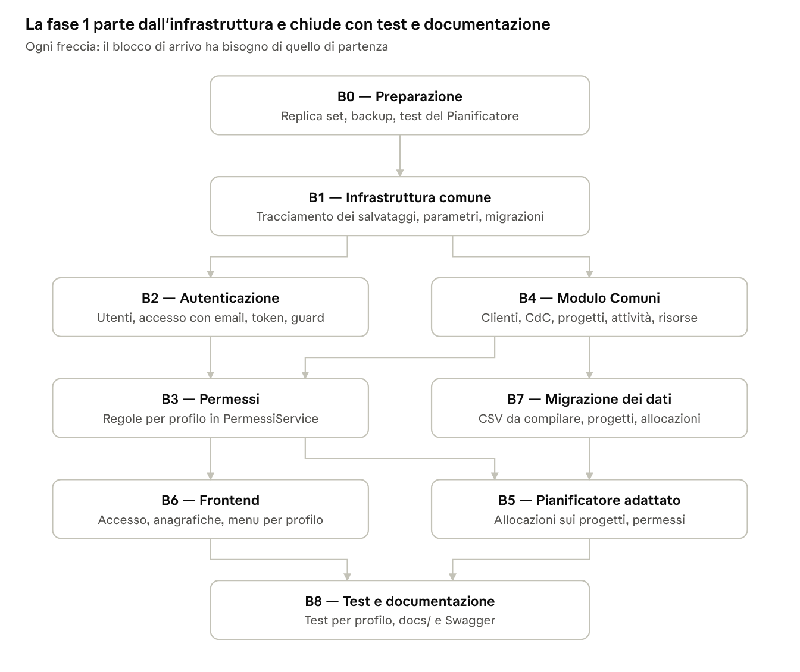

# ToolPM — Piano della fase 1: fondamenta

17/11/2026 · Claudio Agasi

> Piano di lavoro della fase 1 (nessun codice ancora scritto). Versione di lavoro con commenti: [documento su Claude](https://claude.ai/artifact/4F7XBCNxnrJ74uSVKqm643). Questo file è la copia salvata nel repository al 17/11/2026. Le decisioni da cui parte sono in [analisi-consuntivazione.md](analisi-consuntivazione.md).

La fase 1 prepara ToolPM per la Consuntivazione: accesso con utenti e profili, modulo Comuni con le anagrafiche condivise e migrazione dei dati del Pianificatore. Non comprende ancora consuntivi, tariffe né EVM.

## Avanzamento

| Blocco | Stato | Note |
| --- | --- | --- |
| B0 — Preparazione | In corso | Codice e documentazione su GitHub (commit del 17/11/2026): test della griglia e del filtro per skill, `/api/health` con il replica set, script `npm run verifica-mongodb`, guida [mongodb-replica-set.md](mongodb-replica-set.md), nuove variabili in `.env.example`. Resta da eseguire sul PC il passaggio di MongoDB a replica set. |
| B1 — Infrastruttura comune | Da fare | |
| B2 — Autenticazione | Da fare | |
| B3 — Permessi | Da fare | |
| B4 — Modulo Comuni | Da fare | |
| B5 — Pianificatore adattato | Da fare | |
| B6 — Frontend | Da fare | |
| B7 — Migrazione dei dati | Da fare | |
| B8 — Test e documentazione | Da fare | |

## Obiettivo e perimetro

Alla fine della fase 1 ogni utente entra in ToolPM con la propria email, vede e modifica solo ciò che il suo profilo consente, e Pianificatore e Consuntivazione condividono le stesse anagrafiche in un modulo Comuni.

**Compreso nella fase 1**

- Autenticazione con email e password, abilitazioni TL, PM e PMSenior, ruoli applicativi `risorsa`, `controller`, `admin`.
- Controllo dei permessi su tutte le API, comprese quelle del Pianificatore.
- Tracciamento dei salvataggi (`creatoIl`, `creatoDa`, `modificatoIl`, `modificatoDa`) su ogni documento.
- Modulo Comuni: clienti, centri di costo, ruoli, risorse (con email, cellulare, abilitazione, ruolo e orario), progetti (stati, date, stime, percentuale di completamento, approvatori), attività (stima in giorni, percentuale, risorse assegnate), storico dell'avanzamento.
- Migrazione dei dati del Pianificatore verso le nuove anagrafiche.
- Pagine del frontend per accesso e anagrafiche comuni; Pianificatore adattato ai nuovi dati.
- MongoDB configurato come replica set.

**Fuori dalla fase 1**

- Tipologie di costo, tariffe, consuntivi e calcolo dei costi (fase 2).
- Invio e approvazione delle righe, chiusura dei periodi (fase 3).
- Report, indicatori EVM e confronto pianificato contro consuntivato (fase 4).
- Integrazioni con altri sistemi (fase 5, facoltativa).

## Punto di partenza

Oggi ToolPM ha solo la sezione Pianificatore, senza autenticazione, e i progetti esistono solo come testo libero dentro le allocazioni delle risorse (repository `toolpm`, commit `fba438b`).

| Area | Stato attuale | Cosa cambia nella fase 1 |
| --- | --- | --- |
| Backend | NestJS 12, moduli `pianificatore/risorse`, `pianificatore/anagrafiche`, `pianificatore/pianificazione` sotto `/api/pianificatore` | Nuovi moduli `auth`, `comuni`, `infrastruttura`; le risorse passano in `comuni` |
| Risorse | Collection `risorse` con nome, cognome, skill, certificazioni e allocazioni `planned` incorporate | Si aggiungono email, cellulare, matricola, abilitazione, ruolo con storico, orario, date di ingresso e uscita |
| Progetti | Nessuna anagrafica: `planned.cliente` e `planned.progetto` sono testo libero | Collection `clienti`, `progetti`, `attivita`; le allocazioni puntano a `progettoId` |
| Accesso | Nessuno: chiunque raggiunga l'applicazione legge e modifica tutto | Login, token, controllo dei permessi su ogni API |
| Database | MongoDB su Docker Desktop, istanza singola, `autoIndex` disattivato | Replica set a un nodo; indici creati con script di migrazione |
| Test | Un test backend (`mesi.spec.ts`) e uno frontend (`app.spec.ts`) | Test su permessi, anagrafiche e migrazione |
| Dati di esempio | `db/risorse.json`: 13 risorse, 5 coppie cliente/progetto distinte (TIM – TIMBUFE, TIMENTFE, TIMBUSINESS; Ebitemp – PortaleWeb; Agocm – Reigegnerizzazione ROC) | Diventano clienti e progetti veri tramite la migrazione |

## Ordine dei lavori

I blocchi partono dall'infrastruttura comune; poi autenticazione e modulo Comuni procedono in parallelo e si ricongiungono nei permessi.

La migrazione (B7) può partire appena il modulo Comuni è pronto, ma ha bisogno dei due file CSV compilati; il Pianificatore adattato (B5) aspetta sia i permessi sia la migrazione.

## Blocchi di lavoro

La fase 1 si divide in otto blocchi. Ogni blocco si chiude con codice, test e documentazione aggiornata in `docs/`, ed è rilasciabile da solo.

### B0 — Preparazione

- MongoDB su Docker Desktop come replica set a un nodo (`--replSet rs0`, poi `rs.initiate()`), con aggiornamento di `MONGODB_URI` nel `docker-compose.yml`.
- Backup del database `toolpm` prima di ogni migrazione.
- Test sul calcolo della griglia e sul filtro per skill del Pianificatore, oggi mancanti: servono a verificare che le modifiche successive non lo rompano.
- Nuove variabili d'ambiente in `.env.example`: segreto e durata del token, credenziali del primo amministratore.

### B1 — Infrastruttura comune

- Cartella `backend/src/infrastruttura/`: plugin Mongoose globale per `creatoIl`, `creatoDa`, `modificatoIl`, `modificatoDa`, con l'utente corrente letto da AsyncLocalStorage; utenti tecnici `sistema:...` per script e procedure.
- Interceptor che apre il contesto dell'utente a ogni richiesta.
- Collection `parametri` (ore per giorno, soglie EVM) e collection `migrazioni` che registra gli script già eseguiti.
- Script di migrazione numerati in `backend/scripts/migrazioni/`, eseguibili con `npm run migra` e ripetibili senza danni.

### B2 — Autenticazione

- Modulo `backend/src/auth/` e collection `utenti`: risorsa collegata, email come nome utente, password cifrata (argon2), abilitazione (TL, PM, PMSenior o nessuna), ruoli applicativi (`risorsa`, `controller`, `admin`), attivo sì/no, ultimo accesso.
- API `POST /api/auth/login`, `POST /api/auth/logout`, `GET /api/auth/me`; token JWT in un cookie httpOnly.
- Guard globale: ogni API richiede l'accesso, salvo quelle marcate `@Pubblica()` (login, `/api/health`).
- Gestione utenti per l'amministratore: creazione, disattivazione, abilitazione, reimpostazione della password. Nessun invio di email nella fase 1.

### B3 — Permessi

- Servizio `PermessiService` che risponde a domande precise: può creare un progetto, modificarlo, cambiarne lo stato, gestire le sue attività, modificarne la percentuale, modificare una risorsa o le sue caratteristiche.
- Le regole sono quelle decise nell'analisi: profilo sul progetto, PMSenior su tutto, TL sulle caratteristiche delle risorse che lavorano sui suoi progetti. Nella fase 1 "lavorano" significa allocate nel Pianificatore; le ore consuntivate si aggiungono nella fase 2.
- Decoratori sui controller e filtri nei servizi, così gli elenchi restituiscono solo ciò che l'utente può vedere.

### B4 — Modulo Comuni

- Modulo `backend/src/comuni/` registrato su `/api/comuni`, con sottomoduli clienti, centri di costo, ruoli, risorse, progetti, attività e avanzamenti.
- Progetti: codice univoco, titolo, descrizione, cliente facoltativo, centro di costo obbligatorio, date, stato con passaggi controllati (inizio obbligatorio per In corso, fine per Chiuso, riapertura solo da PM o PMSenior), quattro stime, percentuale di completamento, approvatori con profilo (almeno un PM), opzione "solo su attività".
- Attività: codice univoco nel progetto, descrizione, date, stato, stima in giorni, percentuale, risorse assegnate.
- Ogni cambio di percentuale scrive nello storico `avanzamenti`.
- Validatori `$jsonSchema` sulle nuove collection e indici creati dagli script di migrazione.

### B5 — Pianificatore adattato

- Le API del Pianificatore leggono le risorse dal modulo Comuni e passano sotto il controllo degli accessi.
- Le allocazioni (`planned`) usano `progettoId` al posto dei testi `cliente` e `progetto`; il cliente si ricava dal progetto.
- Modifica delle caratteristiche (skill, certificazioni, allocazioni) consentita secondo i permessi del blocco B3.
- Per un rilascio restano attivi anche i vecchi percorsi `/api/pianificatore/risorse`, che inoltrano a `/api/comuni/risorse`.

### B6 — Frontend

- Pagina di accesso, interceptor HTTP, protezione delle rotte, uscita; il menu mostra solo le voci consentite al profilo.
- Nuova sezione "Anagrafiche" (`/toolpm/comuni/...`): clienti, centri di costo, progetti con attività, approvatori, stime e stato, risorse, utenti (solo amministratore).
- Pianificatore: scelta del progetto da elenco invece del testo libero; nuovi campi della risorsa (email, cellulare, ruolo, orario).

### B7 — Migrazione dei dati

Descritta nella sezione successiva.

### B8 — Test e documentazione

- Test dei permessi per ogni profilo, dei passaggi di stato dei progetti e della migrazione su una copia del database.
- Aggiornamento di `docs/architettura.md`, `backend.md`, `frontend.md`, `database.md` e di Swagger.

## Migrazione dei dati del Pianificatore

La migrazione trasforma i dati del database `toolpm` con script controllabili e ripetibili, e ha bisogno di due file da compilare a mano: oggi le risorse non hanno email e i progetti non hanno centro di costo né PM. Il database `pianificazione` del vecchio pianificatore non viene toccato.

1. **Backup.** `mongodump` del database `toolpm`; ogni script si prova prima su una copia.
2. **Struttura.** Creazione di indici e validatori delle nuove collection, parametri iniziali (8 ore per giorno, soglie EVM), primo amministratore dalle variabili d'ambiente.
3. **Tracciamento.** Sui documenti esistenti (`risorse`, `skills`, `rate`, `certificazioni`) si impostano `creatoIl` e `modificatoIl` alla data della migrazione e `creatoDa`, `modificatoDa` all'utente tecnico `sistema:migrazione`.
4. **Elenco da compilare.** Uno script produce due file CSV:
   - `risorse.csv`: una riga per risorsa con cognome e nome già compilati; da completare con email, cellulare, matricola, ruolo, orario contrattuale e abilitazione.
   - `progetti.csv`: una riga per ogni coppia cliente/progetto trovata nelle allocazioni (nei dati di esempio sono 5); da completare con codice e titolo corretti, centro di costo, PM e TL, stato e date. È il momento per correggere i refusi, per esempio "Reigegnerizzazione ROC".
5. **Importazione.** Un secondo script legge i due file compilati e crea clienti, centri di costo, progetti con approvatori e utenti. Le risorse senza email restano "da completare" e non possono accedere.
6. **Collegamento delle allocazioni.** Ogni allocazione con cliente e progetto testuali riceve il `progettoId` corrispondente. I testi originali restano per un rilascio come `clienteTesto` e `progettoTesto`, poi si eliminano.
7. **Verifica.** Conteggi prima e dopo; nessuna allocazione con testo senza `progettoId`; la griglia del Pianificatore per gli stessi mesi deve dare le stesse percentuali di prima.

Gli script si registrano nella collection `migrazioni`: rieseguirli non duplica nulla.

## Criteri di completamento

La fase 1 è finita quando tutte queste verifiche passano, con test automatici dove possibile.

- [ ] Senza accesso ogni API risponde 401, tranne login e `/api/health`.
- [ ] Per ogni profilo (risorsa, TL, PM, PMSenior, controller, admin) un test verifica cosa può e cosa non può fare su progetti, attività, risorse e caratteristiche.
- [ ] Un progetto non si attiva senza un PM, non passa In corso senza data di inizio e non passa a Chiuso senza data di fine.
- [ ] Ogni documento salvato ha `creatoIl`, `creatoDa`, `modificatoIl`, `modificatoDa` con l'utente giusto.
- [ ] Ogni cambio di percentuale di completamento compare nello storico `avanzamenti`.
- [ ] Tutte le allocazioni del Pianificatore puntano a un progetto e la griglia dà le stesse percentuali di prima della migrazione.
- [ ] `docker compose up` avvia ToolPM su MongoDB in replica set; il vecchio pianificatore sulle porte 4200/3000 continua a funzionare.
- [ ] Documentazione in `docs/` e Swagger aggiornati.

## Rischi e decisioni prima di iniziare

Le tre decisioni e le contromisure sono state confermate il 17/11/2026.

- **Accesso:** password gestite da ToolPM nella fase 1. L'accesso con account aziendale (per esempio Microsoft 365 o Google Workspace) si potrà aggiungere senza cambiare il modello, perché il nome utente è già l'email.
- **File da compilare:** `risorse.csv` e `progetti.csv` (email, centri di costo, PM e TL, clienti e centri di costo iniziali) li compila l'amministrazione, prima del blocco B7.
- **Vecchi percorsi:** `/api/pianificatore/risorse` resta attivo per un rilascio, poi si elimina.

| Rischio | Effetto | Contromisura |
| --- | --- | --- |
| Dati mancanti nei due file CSV | Risorse senza accesso, progetti senza PM o centro di costo | Le risorse senza email restano "da completare"; lo script rifiuta i progetti incompleti e li elenca |
| Replica set su Docker Desktop | Cambia la stringa di connessione; il vecchio pianificatore usa la stessa istanza | Prova su una copia; verifica del vecchio pianificatore nei criteri di completamento |
| Regressioni nel Pianificatore | Percentuali della griglia diverse da prima | Test del blocco B0 e confronto della griglia prima e dopo la migrazione |
| Regole dei permessi complesse | Utenti che vedono o modificano troppo, o troppo poco | Tutte le regole in `PermessiService`, con un test per profilo |
